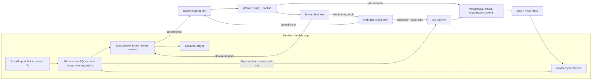

# Song Sleeve implementation plan

**Status:** planning; plan revision 2 (restructured for implementation), describing the **v1 release**
**Last updated:** 2026-10-13
**History:** [plan revision 1](research/implementation-plan-v1.md) · [review and owner decisions](implementation-plan-review.md)

## How to use this document

| Part | Use it for |
| --- | --- |
| [1. Product](#1-product) | Scope, platforms, the two kinds of songs, glossary |
| [2. Core rules](#2-core-rules) | The invariants. Each rule is stated **once** with a stable ID (`R-…`). Other sections cite the ID instead of restating the rule |
| [3. State model](#3-state-model) | Every status a song, operation or device can be in, with its UI label |
| [4. Architecture](#4-architecture) | Stack, components, repository layout, engineering conventions |
| [5. Data model](#5-data-model) | Server PostgreSQL and device-local schemas |
| [6. API](#6-api) | Endpoints grouped by module and the shared request contract |
| [7. Flows](#7-flows) | Step-by-step behavior that combines the rules |
| [8. Screens and player](#8-screens-and-player) | UI requirements and visual tokens |
| [9. Platform adapters](#9-platform-adapters) | Web, desktop and mobile specifics |
| [10. Infrastructure](#10-infrastructure-and-operations) | Railway, bucket, Vercel, deployment, operations |
| [11. Open decisions and spikes](#11-open-decisions-and-spikes) | Everything not yet decided or proven (`D-…`, `S-…`) |
| [12. Delivery plan](#12-delivery-plan) | Dependency-ordered milestones with exit tests |

Choices still open are listed as **Open** in [§11](#11-open-decisions-and-spikes); everything else in this plan is decided. The repository layout and supporting libraries (§4.1, §4.3) are proposals confirmed when M0 starts.

---

## 1. Product

### 1.1 Direction

Song Sleeve is a **local-first** music player with an **opt-in cloud library**. There are two kinds of songs:

- **Synced songs** have an account-level **track document** in PostgreSQL and one verified audio file in a private bucket. Every device on the account sees them. Installed apps mirror them into their local `Songs` directory and play from it. The web plays them from the cloud.
- **Local songs** (also called **unsynced songs**) exist **only on the device that imported them**. Their audio file stays wherever it already is in the device's storage; it is never placed in `Songs`. The device's database records the song and points to that file. The server stores nothing about them: no metadata, no paths, no counts. Other devices can't see them. Uninstalling the app or clearing its data loses the songs and every change made to them (the files themselves stay where they are). They become account data only when the user syncs them.

Organization is account-level: optional artists, manual playlists (of songs) and manual groups (of playlists). A playlist can contain local songs, but those memberships are stored only on the device that owns the songs (a *device overlay*). On every other device the same playlist shows only its synced songs. Until a local song is synced, it is a "ghost" everywhere except its own device.

<a id="drive"></a>

### 1.2 Platforms and scope

| Platform | Local songs | Synced songs | Notes |
| --- | --- | --- | --- |
| **Desktop app** (Windows, Linux) | Yes (the file stays where it is) | Mirrored to local `Songs` and played locally | Wails, with Electron as the fallback (D-1). macOS comes later |
| **Mobile app** (Android, Capacitor) | Yes (the file stays where it is) | Mirrored to local `Songs` and played locally | Native player and background work. iOS comes later: Capacitor supports it, but there's no Mac or iPhone to build and test on (D-22) |
| **Web app** (Vercel) | **No** | Played from the cloud, one whole song at a time | **Owner-only in this release** (R-WEB-ACCESS, D-26): built and tested as milestone M3, but only allowlisted accounts can register or sign in. Online-only: nothing offline, nothing stored on the device (R-WEB). Songs added on the web are synced automatically. Asking to keep a song local shows an "install the app" alert |
| **Landing page** (Vercel, public) | — | — | The only public web presence in this release (R-SITE, D-26): presents the app and its features and links to the downloads. No account, no sign-in, no API calls |

| In scope (v1 release) | Out of scope (v1 release) |
| --- | --- |
| Adding songs from local files only: file and folder import (installed apps), file upload (web) | Streaming or progressive playback; URL-based downloads; Google Drive or any other cloud import |
| Opt-in sync by song, playlist, group or the whole library, for allowlisted accounts first (R-CLOUD-8) | Smart or rule-based collections; nested groups |
| Email-and-password accounts (no email verification for now), 90-day sessions, password reset, irreversible deletion | Duplicate detection or reusing content by checksum |
| Persistent player, system media controls, background updates | Cover-art lookup; gapless playback or crossfade; transcoding or trimming |
| | The iOS app (later, D-22) |
| | A public web app: sign-in and playback on the web for anyone but allowlisted accounts (D-26) |
| | Sorting lists by name, artist or date (order is manual only); album and track number; an in-app volume control (the system volume is used) (D-36) |
| | Database backup policy and restore drills (later version, D-16); a backup copy of song audio (D-3) |
| | Any offline or on-device storage on the web (D-5); offline edits to server data |

### 1.3 Glossary

| Term | Meaning |
| --- | --- |
| **Synced song / track** | A song saved on the server: a track document (`tracks`) and, once its upload completes, cloud content. Installed apps mirror it in `Songs` |
| **Local song** (= **unsynced song**) | A song that isn't saved on the server and isn't in `Songs`. Its source is a file somewhere in the device's own storage. It and its changes exist only on that installed device and are lost on reinstall. It's a "ghost" everywhere else |
| **Pending track** | A track document created at the start of a sync, before it has any content (R-ID-3). Every device shows it as **Syncing…**; it is deleted if the sync fails (R-ID-4) |
| **Content** | The immutable record of one verified audio payload in the cloud (`track_content`). It is not a version history |
| **`Songs` folder** | The user-visible `Song Sleeve` folder (in the home folder on desktop; a folder the user creates or picks at the top of storage on Android, §9.5), one subfolder per account (R-DEV-4). It holds **only synced songs**: their mirrors, and the file of a song this device is syncing. The user can open and edit it, and the folder check (§7.13) puts it back to an exact mirror of the server |
| **Source file** | The file in device storage that a local song plays in place. The app never modifies, moves or deletes it |
| **Device overlay** | Device-only membership and position entries that place local songs in account playlists and in the library order |
| **Installed app** | The desktop app or the mobile app |
| **Scope** | A sync target: `library`, `playlist` or `group` |
| **Operation** | A server-coordinated change to one track that holds that track's slot (R-SYNC-1) |
| **Device Sync Service** | The listener and reconciliation coordinator, one per installation (R-DEV-1) |
| **Pin** | The device's hold on the file or resource that is currently playing (R-PIN-1) |

Syncing is one-way: there is no unsync. A synced song can only be deleted (§7.8).

UI action names: **Sync to cloud**, **Pause automatic sync**, **Replace audio file**, **Remove from playlist / group**, **Delete song**.

In this plan "local" always means unsynced. A synced song's file in `Songs` is called its **mirror**, never a local song.

---

## 2. Core rules

<a id="authoritative-track-document-and-update-rules"></a><a id="track-identity-throughout-its-lifecycle"></a>

### 2.1 Data ownership (`R-OWN`)

- **R-OWN-1 The server knows only synced songs.** `tracks`, `track_content`, server memberships, artist references, counts and events cover synced songs only. No metadata, path, checksum or count of a local song is ever sent. The one exception is the request that starts syncing that song.
- **R-OWN-2 Local songs exist only on their device.** A local song lives in the account's namespace on one installed device. Its metadata, source-file locator, playlist overlay entries and library position are all local, and so is every change made to them. Reinstalling the app, clearing its data or losing the device loses the song record and those changes; the source file itself stays in device storage. The UI states this the first time the user imports locally, and the Profile screen repeats it.
- **R-OWN-3 Each account has its own device namespace.** All device data is kept per account: `Song Sleeve/{account folder}/…` for the `Songs` mirror and one SQLite database per account in app-private storage. Signing in with another account never shows or touches the first account's data.
- **R-OWN-4 Organization is account-level.** Artists, playlists, groups, the Library view preference and sync scopes are server entities. Local songs take part only through the device overlay (R-ORG-4).
- **R-OWN-5 The web has no local songs.** Everything added on the web is synced (R-CLOUD-2).
- **R-WEB The web is online-only.** It has no offline features and stores nothing on the device: no IndexedDB, OPFS, Cache Storage or service-worker cache, and no audio. The catalog, pending requests and player state live in memory and are fetched again after a reload. The only device files the web ever reads are the ones the user picks to add a song (which syncs at once) or to replace a synced song's audio. Offline or local features require the desktop or mobile app (D-5).
- **R-WEB-ACCESS The web app is owner-only in this release (D-26).** It is a full milestone (M3) and is tested end to end, but only accounts with cloud sync (`users.cloud_sync_enabled`, R-CLOUD-8) can use it.
  - **Server-enforced:** registering from the web with an email outside `CLOUD_SYNC_ALLOWLIST`, or signing in from the web to an account without cloud sync, is rejected with `web_app_unavailable`: "Song Sleeve on the web is coming soon. Download the app to get started." No web session is created. The server tells web requests apart by their session transport (cookie, R-AUTH-3).
  - **Not linked publicly:** the landing page never links to the web app, and the web app is excluded from search engines (`noindex`). Hiding the URL is not the protection; the server check is.
  - Everyone else registers and signs in only in the installed apps.
  - Opening the web to everyone later means removing this check together with opening cloud sync, since the web can only play synced songs. No data changes.
- **R-SITE The public landing page is the only public web interaction (D-26).** A static site that presents Song Sleeve and points to the downloads (§8.5). It has no account features, makes no API calls, sets no cookies and stores nothing.

### 2.2 Synced-track identity and content (`R-ID`)

- **R-ID-1 Each synced song has one document.** The `tracks` row holds `track_id`, owner, name, nullable `artist_id`, duration, byte size, format, checksum, `state` (`pending_upload` or `ready`), `current_content_id` (null while pending), revision and library position. Device paths and access grants never reach the server.
- **R-ID-2 A track ID lives as long as the sync.** The ID is assigned when a sync starts and lasts until the track is deleted. It is never reused. Adding the same file again after a delete creates a new track ID.
- **R-ID-3 Things are created in a fixed order.** Each step completes before the next one starts:
  1. Create the track document, online and without content (`pending_upload`). It includes the metadata, library position and playlist memberships.
  2. On installed apps, place the file in local `Songs` (R-CLOUD-4).
  3. Upload the file to a staging key.
  4. A worker verifies the file and publishes it to its final key (R-CLOUD-5).
  5. One transaction sets `current_content_id`, sets `state=ready` and appends the event.

  A replacement follows the same order on an existing track. The old content stays current until the switch in step 5. If any step fails, the whole sync is undone (R-ID-4).
- **R-ID-4 A sync is all-or-nothing, and its progress is visible on every device (D-7).**
  - **Visible everywhere:** once the track document exists, every device lists the song and its playlist memberships with **Syncing… x%**. Other devices can't play or download it until it is `ready`; the originating device keeps playing it from its source file.
  - **Progress:** the uploading device reports confirmed bytes with its heartbeat, and the server can also read the parts already in the bucket. The server stores the progress on the operation and sends a coalesced progress hint over SSE (at most every few seconds). Progress hints are not `account_events` rows; a device that connects later reads progress from the operation.
  - **All-or-nothing:** a sync ends in exactly one of two ways:
    - **Success:** the content is set and the track becomes `ready` (R-ID-3 step 5).
    - **Failure:** one server transaction deletes the track document, its memberships and its operation, and appends a `track_sync_failed` event. Workers then delete its staging objects and abort partial multipart uploads. Every device removes the song as if it never existed on the server.
  - **What counts as a failure:**
    - the worker rejects the file (checksum, limits, invalid audio)
    - the user cancels, or deletes the syncing song, from any device
    - the upload stops making progress for longer than the stall timeout (**5 minutes**, D-7): a closed tab, a killed app, a device that went offline
    - an upload error that can't be retried

    Network errors are retried automatically on the same operation, as long as the stall timeout hasn't passed.
  - **After a failure, on the originating device:** the `Songs` copy is removed, and the song is local again with its overlay entries restored. It is marked `sync_failed` and shows **Sync failed: {reason}** with **Try again**, which puts it back in the queue as a new sync with a new track ID (R-ID-2). On the web the tab shows the failure, and nothing is kept.
  - **No automatic retry of a failed sync (D-25).** A failed song is never re-queued by itself: auto-sync and enabled scopes skip `sync_failed` songs. Only the user retries, either one song (**Try again**) or in bulk (**Retry failed syncs** on Songs, a playlist or a group, which re-queues only that list's failed songs). Within one running sync, resuming an interrupted upload part on the same operation is not a retry and still happens automatically until the stall timeout.
  - **Replacements are all-or-nothing too, but a failure never deletes the song.** A song is never left without audio:
    - The old content stays current, playable and stored in the bucket for the whole replacement. Every device shows **Updating audio… x%** and keeps playing it.
    - The old content is retired only in the same transaction that switches to the new content, after the new upload has finished and been verified (R-ID-3 step 5). Its file is deleted after that.
    - Any failure (the same list as above, including the 5-minute stall) discards the new upload and its staging. The song keeps its old content and metadata, and the suggestion choices are not applied.
  - **Keeping progress visible within 5 minutes:** uploads use multipart parts small enough that each one finishes well within the timeout on a slow connection. The server counts progress from heartbeats or from parts that arrive in the bucket, so a mobile upload the OS moved to the background still counts as long as parts keep arriving.
- **R-ID-5 Every explicit replacement creates fresh content.** Confirming any file as a synced song's new audio creates new content with a fresh immutable ID. The old content is retired only when the new content becomes current (R-ID-4). This happens even when the file or its checksum is identical. There's no checksum shortcut, duplicate detection or reuse. A network retry with the same request ID continues the same operation. Downloading or mirroring existing content never creates content.
- **R-ID-6 Integrity is checked with SHA-256.** The checksum is SHA-256 over the complete file, and sizes are exact byte counts. Multipart ETags are never treated as checksums.
- **R-ID-7 Retired content is never played again.** After a replacement or removal, the old content can't start new playback anywhere. The only temporary exception is a playback pin (R-PIN-1).

### 2.3 Local songs (`R-LOCAL`)

- **R-LOCAL-1 Local import works offline and keeps files where they are.** Installed apps import a local song by recording a locator (desktop path, or Android SAF URI) to its source file in device storage. Nothing is copied into `Songs`, and no server is involved.
- **R-LOCAL-2 Local changes stay on the device and work offline (D-18).** The server never sees them, and they are lost on reinstall like the song itself. The following change only device data, so they work without a connection:
  - renaming a local song, or changing its artist
  - pointing it at another source file (**Replace audio file**)
  - deleting it
  - adding, removing or reordering its overlay entries

  Changing server data still follows R-MUT-1.
- **R-LOCAL-3 External changes only affect health.** If someone edits, renames, moves or replaces a source file outside the app, only the song's health changes (`source_changed`, `needs_relink`, `access_denied`). The saved metadata never changes on its own. Only **Replace audio file** rereads the file.
- **R-LOCAL-4 The app never touches files outside `Songs`.** Import, sync, delete, logout and account deletion never modify or delete source files. A local song's source can't be inside the `Song Sleeve` folder: import rejects such files with "This file is in the Song Sleeve folder, which only holds synced songs." The app writes outside `Songs` only to create a new file the user asked for.
- **R-LOCAL-5 Syncing is one-way.** There is no unsync: a synced song never goes back to being local. To take a song out of the cloud, the user deletes it (§7.8), which removes it from every device.

<a id="online-only-changes-and-server-acceptance"></a>

### 2.4 Online-only server mutations (`R-MUT`)

- **R-MUT-1 Changes to server data need the server to accept them.** This covers: creating, syncing, replacing or deleting synced songs; their metadata; artists; playlists and groups, with their server memberships and order; the Library preference; and scopes. Each change needs a live authenticated request that the server accepts. If there is no connection, show `connection_required`: **"Connect to the server to make changes. This change was not saved."**
- **R-MUT-2 Nothing is applied before acceptance.** The client never updates its cache optimistically, never persists a final drag order, and never replays a disconnected attempt later. Form input, file review, staging and drag previews stay uncommitted. Staged files are deleted if the change is rejected or cancelled. A network indicator alone never counts as being connected.
- **R-MUT-3 Every change carries a revision and a receipt.** Each mutation sends the revision it expects and a unique request ID. The server checks ownership, revision and constraints, then commits the change, its receipt and an account event in one transaction. If the revision is stale, the server rejects the change; the client refreshes and asks the user to confirm again. Sending the same request ID again returns the original result.
- **R-MUT-4 An unknown result is recovered, not resent.** If the client can't tell whether a change went through, it shows **"Could not confirm this change. Reconnect to check its status."** It keeps the request ID and asks `GET /me/mutations/{requestID}` once reconnected. It never resubmits the change as a new action.
- **R-MUT-5 The user chooses replacement metadata first.** This rule covers what happens when a new file is picked for a song that already has a name or artist:
  - **Suggestion step.** For each field, show the current value next to the value extracted from the new file. The user picks **Keep current** or **Use new**, or types a value. This happens *before anything is applied or uploaded*.
  - **Upload.** It starts only after the user confirms (R-ID-3). The chosen field values and the new content commit in the same transaction.
  - **Conflict.** If another device changed one of those fields during the upload, the content switch still commits, and that field is shown again as a suggestion (the newer value versus the user's choice). It is never overwritten silently.
  - **No reverts.** A later upload completion never undoes a metadata-only edit.
  - **Local songs** use the same suggestion step, applied on the device.
- **R-MUT-6 Accounts can't reach each other's data.** Every relationship stays within one user: composite `(user_id, id)` foreign keys, plus an ownership check in every query and every object-storage operation. Knowing an ID never grants access.

<a id="organize-music"></a>

### 2.5 Organization (`R-ORG`)

- **R-ORG-1 Organization is manual and fixed.** There are only artists, playlists (which hold songs) and groups (which hold playlists). There is no nesting, no parent IDs, no rules and no rule worker. Requests with unsupported child types or rule fields are rejected.
- **R-ORG-2 Artists are set explicitly.** The artist field is optional and starts blank. A suggestion never assigns or creates an artist unless the user confirms it.
  - **Synced songs:** saving one creates the server artist, or reuses an existing one with the same normalized name.
  - **Local songs:** they store the artist name locally and link to an existing server artist with the same normalized name. A new name creates its server artist only when the song syncs.
  - **Smart artist search (D-10).** Wherever an artist is picked (adding songs, editing a song, the replacement suggestion step), the field searches as the user types and shows existing artists with **similar** names, not only exact ones. Before **New artist "{typed}"** is created, any similar artist is shown first as **Did you mean {artist}?** The user decides; nothing is merged or replaced automatically, and creating a new artist with a similar name is still allowed.
    - **Similarity** ignores case, accents, punctuation and spacing (`AC/DC` ≈ `ACDC`, `Beyoncé` ≈ `Beyonce`), a leading "The" (`Beatles` ≈ `The Beatles`), and `&`/`and`/`n'` (`Guns N' Roses` ≈ `Guns and Roses`). It also tolerates small typos (`Metalica` ≈ `Metallica`) and matches word starts (`zep` finds `Led Zeppelin`).
    - **Ranking:** exact match, then names starting with the text, then similar names; at most 8 results.
    - **One matcher for every platform:** it lives in `packages/core` and runs on the artist list the client already has (the replica on installed apps, plus this device's local-song artist names; the in-memory catalog on the web). The artist list is small, so no server-side fuzzy search is needed.
    - The filename hint (§7.1 step 2) goes through the same matcher, so a suggested "Beatles" offers the existing **The Beatles**.
- **R-ORG-3 Membership is by reference.** A song can be in many playlists, and a playlist can be in many groups. References never duplicate audio.
- **R-ORG-4 Local songs join playlists through the device overlay.** A local song can be added to any account playlist. The overlay entry (`playlist_id`, `local_song_id`, position) is stored only on that device, so other devices see the playlist without it. When the local song syncs, the request that creates its track document (R-ID-3) submits its overlay entries as server memberships, and the device removes those entries. If the playlist is deleted, the device drops its overlay entries.
  - **Playlist deleted during a sync (F-10):** the server keeps only memberships to playlists that still exist when it creates the track, and returns the dropped ones as `dropped_playlist_ids`. It never rejects the sync for this; the device removes those overlay entries.
  - **Artists of local songs (F-10):** a local song stores the artist **name**; the matched `artist_id` is only a cache. When the server artist is renamed, the device updates local songs linked to it to the new name. When it's deleted (only possible while no synced song uses it), local songs keep the name and lose the link. At sync time the device sends the cached `artist_id` if the artist still exists, otherwise the name, which the server reuses or creates by normalized name (R-ORG-2).
- **R-ORG-5 Removing is not deleting.** **Remove from playlist / group** removes only the membership. Deleting a playlist keeps its songs and takes the playlist out of its groups. Deleting a group keeps its playlists. Only **Delete song** deletes a song.
- **R-ORG-6 All ordering uses one key space.** Library, playlist and group order use fractional or lexicographic position keys, so a move writes a single row. Server items and overlay items share the same key space, so a device can merge them by key, breaking ties by ID.
  - Moving a synced item needs the server. Moving a local item is local.
  - New songs and members are appended at the end.
  - Long lists also offer **Move to top/bottom**.
  - The server rebalances keys when needed.
- **R-ORG-7 Display preferences aren't organization.** The Library type filter (Songs, Playlists, Groups; all on by default; at least one must stay on) is an account preference.

<a id="optional-cloud-sync-and-local-playback"></a>

### 2.6 Cloud sync (`R-CLOUD`)

- **R-CLOUD-1 Installed apps sync by opt-in.** A local song syncs when the user confirms **Sync to cloud** for:
  - that song
  - a playlist or group (only its local songs on this device)
  - the whole library

  A confirmed scope is saved on the server. From then on, every installed device automatically syncs its own local songs that enter an enabled scope. Only the device that holds a local song can sync it.
- **R-CLOUD-2 The web syncs everything automatically** (accounts with cloud sync, R-CLOUD-8). A song added on the web is uploaded as a synced song right away. If the user asks to keep a song only on this device, the web shows **"To keep songs only on this device, install the Song Sleeve app."** with links to the downloads, and does not import the song.
- **R-CLOUD-3 Files are checked before upload.** Before syncing, the file's size and SHA-256 are compared with the facts saved for the local song. If they don't match, the upload is blocked and the song shows **Needs attention** until the user runs **Replace audio file**. Saved scopes never adopt external changes on their own.
- **R-CLOUD-4 The file goes into `Songs` before upload.** Installed apps first copy the source file into `Songs` (temp file, verify, atomic install), then upload exactly those bytes. The source file stays where it was, untouched: syncing always copies, never moves, and never offers to delete the original. The duplicate space this uses is accepted (owner decision). After the sync, the device plays only the `Songs` mirror. The web uploads straight from the file the user picked.
- **R-CLOUD-5 Published files are immutable.** Clients upload only to a per-attempt staging key, using a short-lived grant. A trusted worker then publishes the file in five steps:
  1. Verify the actual bytes: length, SHA-256, a positive and finite duration, a supported codec (D-8, probed from the bytes), and R-LIM-1.
  2. Write them to a fresh final key, `users/{userID}/songs/{contentID}`, that has never received a client grant.
  3. Verify the final object again.
  4. Recheck the operation and account fences.
  5. Commit step 5 of R-ID-3.

  The worker's second upload doubles service egress. Conditional copy can replace it only after spike S3 proves it works.
- **R-CLOUD-6 The bucket is where installed apps sync from.** They download synced content into `Songs` and play it locally; they never stream from the bucket. The web fetches one whole song per playback (R-PLAY-2).
- **R-CLOUD-8 Cloud sync is an upcoming feature, enabled per account (D-23).** In the first release only allowlisted accounts can sync; everyone else uses local songs only.
  - **Who has it:** `users.cloud_sync_enabled`. It is set to true at registration when the email is in the server's `CLOUD_SYNC_ALLOWLIST` setting (the owner's email), and false for everyone else. Opening sync to all users later means changing the default; no data changes.
  - **Enforced by the server:** for an account without sync, every sync-related request is rejected with `cloud_sync_unavailable`: creating a track, replacements, upload and download grants, and enabling scopes. Without sync an account has no synced songs, so it uses no bucket storage and its quota is 0.
  - **Still available without sync:** registration, login, and the account-level organization (artists, playlists, groups, preferences) that local songs join through the overlay. These use only the database, never the bucket.
  - **UI:** **Sync to cloud** and the scope actions show **Coming soon** and can't be started. An account without sync can't use the web app at all (R-WEB-ACCESS).
- **R-CLOUD-9 Syncs run through a per-device queue with three workers (D-24).**
  - Every song to sync (one song, a multi-file add, a scope, auto-sync) enters the device's sync queue as `queued`. Queued songs are still local and the server knows nothing about them.
  - Three workers per device take songs from the queue and sync them in parallel. A worker creates the song's track document (R-ID-3 step 1) only when it starts that song, so only songs actually uploading are visible as **Syncing…** and subject to the stall timeout.
  - Each song is independent: one song's failure never stops, cancels or delays the others in the batch.
  - The queue survives a restart on installed apps (`pending_work`). On the web it lives in the tab's memory, so closing the tab drops the songs that haven't started.
  - The worker count is a client setting (3 to start).
- **R-CLOUD-7 Pausing keeps songs synced.** **Pause automatic sync** stops future automatic syncing for a scope. Songs that are already synced stay synced.

<a id="serialized-sync-and-device-notifications"></a>

### 2.7 Serialization and events (`R-SYNC`, `R-EVT`)

- **R-SYNC-1 Only one change per track runs at a time.** Each `(user_id, track_id)` has one slot, covering initial upload, replacement and delete from every device. The slot is keyed on the stable track ID, never on content.
  - Different tracks run concurrently.
  - Metadata-only edits, playback and **downloads of immutable content** don't take the slot (D-19). (Plan revision 1 had downloads take it.)
  - Without the slot, a download can overlap a replacement or delete. The file it fetches is still a valid, immutable content ID: the device installs it only if that ID is still current, otherwise it discards it. The bucket object of retired content is deleted only after the download grants issued for it have expired.
- **R-SYNC-2 Changes queue instead of overlapping.** While the slot is busy, no second operation or grant starts. A retry with the same request ID attaches to the running operation. A different submission waits in the queue and shows **Waiting for another sync operation**.
  - A waiting operation has no stall clock. Its 5-minute stall timer starts when it becomes active (F-22).
- **R-SYNC-3 Queued operations are rechecked before they start.** A queued operation checks revision, ownership and track state before starting. If its target is gone (for example, deleted in the meantime), it is cancelled with an explanation.
- **R-SYNC-4 Slots are never released by a timeout race.** The slot stores ownership and a heartbeat, not an open database transaction. A failed operation is retried or cancelled before the next one may start. The slot isn't released while issued upload grants could still write: those grants must expire or be retired first.
- **R-SYNC-5 Timing values (D-17).** There is no separate lease: ownership of an operation lapses at the stall timeout.

  | Timer | Value |
  | --- | --- |
  | Heartbeat from the uploading device | 30 s |
  | Stall timeout (no progress fails the operation, R-ID-4) | 5 min |
  | Upload grant (signed link for one part; must be *started* within this time) | 5 min |
  | Download grant (mirror download, web playback fetch) | 15 min |
  | Mutation receipt retention (R-MUT-4) | 90 days |

  After a failed operation, the slot frees within about 5 minutes, once its last upload grant expires (R-SYNC-4). All values are server settings and can be tuned without design changes.
- **R-EVT-1 Events are durable.** Each accepted change appends a per-user `account_events` row with a monotonic cursor, in the same transaction as the change. An upload completion is recorded only when the content switches.
- **R-EVT-2 Notifications are hints, not data.** The event stream and push notifications only say that changes are available. Clients then fetch authoritative data through authenticated catch-up. A push never carries catalog data, credentials or object URLs.
- **R-EVT-3 Applying events twice is harmless.** Clients ignore duplicate or older revisions and coalesce to the latest. They advance their cursor only after the events and the local work they cause are saved.
- **R-EVT-4 An expired cursor triggers a full resync.** Events are kept for 90 days (D-15), then deleted by a scheduled job. An expired cursor returns `cursor_expired`, and the client resyncs from a full snapshot.
- **R-EVT-5 Delivered doesn't mean applied.** Each device tracks `received → staged → applied` locally. A stream or push delivery never counts as "applied".

<a id="apply-changes-after-current-playback-finishes"></a>

### 2.8 Devices, pins and playback (`R-DEV`, `R-PIN`, `R-PLAY`)

- **R-DEV-1 Each installation runs one Device Sync Service.** It is independent of routes, screens and the player. The event stream, the push handler, startup, resume and reconnect all call the same reconciliation coordinator. File work is serialized, so foreground and background workers never install or delete the same file at the same time.
- **R-DEV-2 Startup and resume always reconcile.** Real-time and background delivery come on top of this; they never replace it.
- **R-DEV-3 A device deletes only inside its `Songs` folder.** Outside the `Song Sleeve` folder it never deletes anything. Cleanup is tied to content IDs, so a delayed cleanup never removes newer content.
- **R-DEV-4 The `Songs` folder is an exact mirror of the server.** The folder is user-visible and the user may edit it by hand, so the app never trusts it. The **folder check** (§7.13) compares it with the expected set, using a manifest file kept in the folder (D-29), and fixes every difference: missing or altered songs are downloaded again, and every extra file is permanently deleted (D-21), but only after the device has caught up with the server, and with a confirmation above 20 files. Extra files are never imported as songs. The check runs:
  - every time the app opens (startup and resume, as part of §7.9), and on desktop when the folder changes, in quick mode
  - when the user taps **Check Songs folder** in Settings
  - before every change of a synced song's source (§7.7), and the replacement waits for it to finish
- **R-PIN-1 The playing resource is pinned.** If an accepted change affects the song that's playing (a replacement, or a delete from another device), the device keeps the file or Blob, the playback snapshot, the position, the queue and the controls. It shows **"This song was updated. Changes will be applied after playback finishes."** For a removal, the notice says the song will be removed after playback.
- **R-PIN-2 Ending playback releases the pin.** The song ending naturally, a voluntary stop, or switching songs releases it. Pausing or navigating doesn't. With repeat-current-song on, the boundary is processed before the song repeats.
- **R-PIN-3 Pending changes apply when the pin is released.** The staged replacement is installed atomically and the retired file is deleted. If the replacement isn't ready yet, show **Needs download**; never play the retired content again. If nothing is playing, apply the change right away. Library views show the new document immediately.
- **R-PIN-4 The newest pending change wins.** Superseded staged files are discarded. Pending work survives a crash, and after a restart cleanup runs before any new playback.
- **R-PIN-5 Local removals stop playback immediately.** Deleting the current song on this device stops playback at once. So does account deletion, on every device.
- **R-PLAY-1 Installed apps play only local files.** Local songs play their source file in place. Synced songs play from their `Songs` mirror.
- **R-PLAY-2 The web plays one whole cloud song at a time.**
  - Request a read grant, fetch the complete song into one Blob with one object URL, and start playing only after the fetch finishes.
  - Hold exactly one resource. On switching songs, cancel any fetch in progress, stop, clear the source, revoke the URL and release references.
  - Never prefetch, hold a second Blob or keep a persistent cache.
  - Never make an extra `ArrayBuffer`, encode to Base64, or run `decodeAudioData()` on a full song.
- **R-PLAY-3 Unplayable songs stay visible.** Songs that need relinking or downloading, or that are still syncing, stay in every list with their status and actions. The queue skips them.
- **R-PLAY-4 Repeat-one turns off on every track change.** This applies whether the change came from the app, a headset or the system controls.
- **R-PLAY-5…8 Player defaults (D-11).**
  - **Previous** restarts the song if more than 3 s have played; otherwise it goes to the previous song.
  - Turning shuffle off restores the original order, continuing from the current song.
  - The queue is a snapshot of the list when playback starts. Later edits to that list don't change it; removals still apply through pins.
  - After a restart, installed apps restore the last player state, paused. The web starts empty after a reload (R-WEB).

<a id="approved-song-limits"></a>

### 2.9 Song limits (`R-LIM`)

- **R-LIM-1 Every song is limited to 30 minutes AND 128 MiB, both inclusive.** This applies to local and synced songs on every platform, from every source and in every mode, and to every replacement.
  - Duration must be positive, finite and at most 1,800 s.
  - The complete file, including headers and artwork, must be at most 134,217,728 bytes.
  - If either fact is unknown, that's an error. Files are never trimmed or transcoded to fit.
- **R-LIM-2 Every layer enforces the limits.**
  - In the client's review list, invalid rows can't be confirmed.
  - The API checks the declared facts before it creates a track or issues a grant.
  - The worker checks the bytes it actually received.
  - Every download (mirror, web fetch) counts the bytes it receives. It cancels and cleans up on overflow, even if `Content-Length` is missing or wrong.
- **R-LIM-3 An invalid replacement changes nothing.** Staging is cleaned up and the originals are left untouched.
- **R-LIM-4 One endpoint defines the policy.** `GET /media-policy` returns `max_duration_seconds: 1800` and `max_file_bytes: 134217728`. The error codes are `song_too_long`, `song_too_large`, `invalid_audio_metadata`, `unsupported_format`, `storage_quota_exceeded` and `cloud_sync_unavailable`.
- **R-LIM-5 Each account has a cloud storage quota of 25 GB (D-6).**
  - The default is 25 GiB (26,843,545,600 bytes), stored per account so it can be changed for one account or for everyone later.
  - **Usage** is the bytes of every synced song's current content, plus the bytes reserved by syncs and replacements in progress. Local songs never count.
  - **Reservation:** starting a sync or a replacement reserves the file's declared size in the same transaction that creates the track document or the operation. If usage plus the reservation would exceed the quota, the request fails with `storage_quota_exceeded` and nothing is created or uploaded.
  - **Release:** a failed sync or replacement releases its reservation. A replacement's old content stops counting when the switch commits. A deleted song stops counting when its delete commits, even though the bucket cleanup may run later.
  - The worker already checks that the received bytes match the declared size (R-CLOUD-5), so a reservation can't be cheated.
  - **UI:** Profile shows "x GB of 25 GB used"; a warning appears at 90%; a sync blocked by the quota shows **"Your cloud storage is full. Delete synced songs to free space."** On installed apps the song stays local.

### 2.10 Account lifecycle (`R-AUTH`)

- **R-AUTH-1 No email verification for now (D-13).** Registering with an email and password creates the account and signs the user in at once; no verification email is sent. Accepted risk: someone can register an address they don't own, which then blocks its real owner (emails are unique and permanent, R-AUTH-7). Verification can return after the custom domain is set up (§10.3).
- **R-AUTH-2 Only registration reveals that an email is taken.** Without verification, registering an email that's already used must say so: `email_unavailable`, "An account with this email already exists. Log in or reset your password." Registration is rate-limited per IP to slow down probing for accounts. A password-reset request still always returns a generic response.
- **R-AUTH-3 Sessions are opaque and last exactly 90 days.**
  - The lifetime is 7,776,000 s (90 days) with no sliding renewal, and only a hash of the token is stored.
  - Every request checks expiry, revocation and the deletion gate.
  - **Two transports (F-7):** the web gets the session as a Secure HttpOnly cookie, with CSRF protection on every cookie-authenticated write. Installed apps log in with their platform and device ID, get the token in the response body, keep it in the OS secure store and send it as `Authorization: Bearer`; they never use cookies, so CSRF doesn't apply. A session is bound to its transport: a bearer token is never accepted as a cookie, or the reverse.
  - **CORS:** the API allows credentialed CORS only for the exact web origins. Installed apps make their API and bucket requests from native code (Go services on desktop, native plugins on Android), so they need no CORS entry; if a spike shows a webview must call the API directly, its exact origin (for example `wails://wails`, `http://wails.localhost` or Capacitor's `https://localhost`) is added without credentials.
  - **Which client is the web:** cookie sessions are web sessions, which is what R-WEB-ACCESS checks. The sync allowlist (R-CLOUD-8) is enforced on every request regardless of transport.
- **R-AUTH-4 A password reset signs out every device.** It doesn't sign anyone in automatically.
- **R-AUTH-5 Account deletion is irreversible and durable.**
  - It requires reauthentication (a single-use proof valid for 5 minutes) and an explicit confirmation.
  - When accepted, the request and the account gate commit together. There is no cancel.
  - A worker retries until everything is hard-deleted, and deletes the user row last.
- **R-AUTH-6 Authentication failures never delete files.** A 401, a 404, a timeout or a logout never erases local data. Only a confirmed deletion status, read with the restricted cleanup credential, starts a device purge. That purge also removes the account's local-song records; their source files stay in device storage.
- **R-AUTH-7 The email is the account's permanent identity (D-12).** Each email belongs to exactly one account (normalized and unique), and it can't be changed: there is no change-email feature. A user who wants another email creates a new account.
- **R-AUTH-9 Password policy (D-31).** Applies to registration, reset and change:
  - **Length:** at least 10 and at most 128 characters; any characters, including spaces, with no rules about character types. The text is Unicode NFC-normalized before hashing.
  - **Blocklist:** the 10,000 most common passwords are refused with `password_too_common`; a too-short or too-long one gets `password_invalid`.
  - **Hashing:** argon2id with a per-password salt (starting parameters: 64 MiB memory, 3 iterations, parallelism 1, tuned on the API's hardware). The parameters are stored with each hash, so a later change rehashes on the next successful login.
- **R-AUTH-10 Terms are accepted at registration (D-32).** Registration requires ticking **"I agree to the Terms of Use and Privacy Policy"** (both linked). The server stores `terms_accepted_at` and `terms_version`. When the terms change, the next login asks to accept the new version before continuing. Until the final pages are published (§10.3 step 6), registration links to draft versions; only the owner uses the app in that period.
- **R-AUTH-8 Password change requires the current password (D-12).** On Profile, the user enters the current and the new password. On success the server stores the new hash, revokes every other session (the current one stays), and emails "Your password was changed" to the account address. A wrong current password changes nothing and is rate-limited like login.

---

## 3. State model

| Subject | Stored in | Values | UI label |
| --- | --- | --- | --- |
| Synced track | `tracks.state` | `pending_upload`, `ready` | Syncing… x% (every device) · Synced. A failed sync deletes the row (R-ID-4) |
| Operation | `track_sync_operations.state` | `waiting`, `active`, `completed`, `failed`, `cancelled` | Waiting for another sync operation · Uploading x% · Failed (retry) |
| Synced song on an installed device | `synced_files.readiness` | `ready`, `needs_download`, `downloading`, `pending_apply`, `cleanup_pending` | Ready · Downloading · Needs download · Update after playback |
| Local song health | `local_songs.health` | `ready`, `needs_relink`, `source_changed`, `access_denied` | Relink needed · File changed · Access lost |
| Local song sync | `local_songs.sync_state` | `local_only`, `queued`, `syncing`, `sync_failed`, `needs_attention` | On this device only · Queued · Syncing… x% · Sync failed (Try again) · Needs attention |
| Event application | `pending_work.state` | `received`, `staged`, `applied` | — |

**Needs attention** covers four cases: a checksum mismatch before upload (R-CLOUD-3), an unreadable source, an over-limit file, and a replacement field in conflict (R-MUT-5).

---

## 4. Architecture

<a id="recommended-stack"></a><a id="stack-review"></a>

### 4.1 Stack

| Layer | Choice | Responsibility |
| --- | --- | --- |
| Shared UI | React, TypeScript, Vite | All screens, shared by web, desktop and mobile |
| Web | Vite SPA on Vercel | Cloud-only client |
| Desktop (Windows, Linux) | **Wails** (Go local services + React); **Electron** if Wails fails S5 (D-1) | Local songs, `Songs` mirror, local playback, background listener, system media controls |
| Mobile | Capacitor + native plugins | The same as desktop, plus a native player and push/background workers |
| API | Go + Gin | Auth, catalog, mutations, events, operations, grants |
| Workers | Go + **River** on PostgreSQL (D-2) | Email, upload verification and publication, cleanup, account deletion, failed and stalled sync cleanup |
| Catalog | PostgreSQL on Railway | Accounts, synced tracks, organization, operations, events |
| Audio | Railway Storage Bucket (S3-compatible) | One object per current content of a synced song |

**Proposed supporting libraries.** These are proposals, not approved choices. See the [stack review](research/reports/Music%20app%20stack%20review.html).

| Area | Proposal | Gap addressed |
| --- | --- | --- |
| React | React Router, TanStack Query (no persisted or paused mutations), dnd-kit | Navigation, accepted server state, accessible ordering |
| Go | pgx/pgxpool, sqlc, Goose, OpenAPI with oapi-codegen | Typed SQL, tenant and revision transactions, controlled migrations, a typed client |
| Workers | River on PostgreSQL (**decided**, D-2) | Transactional jobs, enqueued in the same transaction as the change that needs them. Its retries and uniqueness don't replace the operation slot or the deletion sweep |
| Installed apps | SQLite per account; file, grant, player-engine, background-transfer and secure-credential adapters; optional paid Capawesome plugins on mobile | Local songs, overlay, replica, pending work |
| Web data | In-memory query cache only (R-WEB) | No persistent browser storage |
| Media | ffprobe in workers; a client-side metadata extractor (S4) | Limits and verification |
| Runtime | SSE with heartbeat, reconnect and replay | Railway edge limits. Database backups are deferred (D-16) |

Keep Capacitor unless spikes S1 and S2 fail. The fallback is React Native with Expo, which has the same OS background limits. Keep Gin and PostgreSQL. The [2026-10-03 storage comparison](research/storage-and-database-research.html) is historical: its advice on streaming, deduplication and providers is superseded.

### 4.2 System diagram



<a id="repository-and-service-shape"></a>

### 4.3 Repository layout (proposed)

```text
apps/web            React + Vite (web build; also the UI bundled by desktop and mobile)
apps/site           Public landing page (static, prerendered; no API client, R-SITE)
apps/desktop        Desktop shell and native side (D-1)
apps/mobile         Capacitor project + native plugins (android/; ios/ later, D-22)
packages/core       TS application services: player controller, catalog store (replica + overlay merge),
                    mutation client, Device Sync Service, local-song service
packages/adapters   Interfaces + per-platform implementations: files/grants, local DB, player engine,
                    credentials, background work, picker
packages/api-client Generated from OpenAPI
server/cmd/api      Gin API
server/cmd/worker   Workers
server/cmd/admin    Operator CLI (§10.5)
server/internal/    accounts, devices, catalog, organization, operations, media, events, deletion
server/db           Goose migrations + sqlc queries
openapi/            API contract (source of truth)
```

Screens call the application services in `packages/core`; they never call platform APIs directly. Everything specific to installed apps (local songs, the overlay, `Songs`) sits behind adapters that the web build leaves out.

### 4.4 Engineering conventions

- **Error envelope:** `{ "error": { "code": "...", "message": "...", "details": {} } }`. The codes are a closed enum in OpenAPI. `connection_required` exists only on the client.
- **Pagination:** cursor-based on the web. Installed apps render from their local replica, which holds the whole account.
- **IDs:** UUIDv7. Timestamps are in UTC.
- **Rate limits** are stored in PostgreSQL or Redis, never in process memory, because the API runs as multiple replicas. They apply to login, registration, password reset, password change, reauthentication and grant issuance.
- **Client compatibility (F-5):** every request carries `X-Client-Platform` (`web`, `desktop`, `android`) and `X-Client-Version`. The server keeps a minimum supported version per platform (a server setting). An older client gets `426 client_update_required`, and the app shows **"Update Song Sleeve to keep syncing."** with the update action (auto-update, the `.deb` notice or the store/APK link, D-28). Installed apps keep playing and editing local songs while blocked. API changes are additive by default; a breaking change ships behind a new route version and raises the minimum only after the new clients are released.
- **Untrusted media (F-12):** audio files are untrusted input.
  - The worker runs ffprobe in a separate process on a temp file, with a 30 s timeout, a memory limit, no network and no shell; its JSON output is parsed strictly. A timeout or crash rejects the file as `invalid_audio_metadata`.
  - Client metadata extractors read at most 16 MiB of tags, run off the UI thread (a web worker or the native side) with a timeout, and treat any parse failure as "no embedded value".
- **Field limits (F-20):** names are trimmed, Unicode NFC-normalized, stripped of control characters and must not be empty. Maximum lengths: song name 200, artist 200, playlist 100, group 100 characters. The same limits apply to local songs. Count caps follow the scale target. Error: `invalid_field`.
- **Scale target (D-33):** per account, up to **10,000 synced songs, 500 playlists, 100 groups and 5,000 songs per playlist**; an installed device also handles up to 10,000 local songs. These are enforced as caps (`limit_reached`) and tested at full size: snapshot paging, list virtualization, SQLite indexes, `queue-ids`, and a full folder check.
- **Logging:** never log raw tokens, links, paths or file contents.
- **Crash and error reporting (D-35):** Sentry (free tier) for the server, the web app and the installed apps. A shared scrubber removes song, artist, playlist and group names, file paths, emails, tokens and URLs before sending. Installed apps have **Send crash reports** in Settings (on by default, explained in the Privacy Policy). On the web there is no session replay and no offline event storage (R-WEB). The landing page has none (R-SITE).
- **Observability:** structured logs with request IDs. Metrics for operation queue age, event lag, worker failures, stalled deletions and pending-track age. Alerts on stalled deletion or cleanup.
- **Testing:**
  - Go unit tests, plus integration tests against real PostgreSQL and MinIO.
  - TypeScript unit tests for `packages/core`.
  - Playwright end-to-end tests for the web and the desktop webview.
  - Device test matrices for mobile.
  - A set of audio fixtures at, just under and just over the limits.
- **CI** runs on every PR: lint, typecheck, tests, an OpenAPI drift check and a migration dry-run.
- **i18n (D-14):** all UI strings and email templates go through a translation layer from M0. Two locales ship: **English (`en`, the default)** and **Brazilian Portuguese (`pt-BR`)**. Dates, numbers and sizes are formatted for the active locale. User content (song, artist, playlist and group names) is never translated.

---

<a id="data-model"></a><a id="data"></a>

## 5. Data model

### 5.1 Server (PostgreSQL)

Every user-owned table carries `user_id`, and relationships use composite `(user_id, id)` foreign keys (R-MUT-6). **No table stores anything about local songs.**

**Accounts and devices**

| Table | Purpose |
| --- | --- |
| `users` | Normalized unique email, argon2id password hash with its parameters (R-AUTH-9), `terms_accepted_at` and `terms_version` (R-AUTH-10), `locale` (`en` default, or `pt-BR`), deletion gate, `suspended_at` (§10.5), `cloud_sync_enabled` (R-CLOUD-8), `storage_quota_bytes` (default 25 GiB; effectively 0 without sync), `storage_used_bytes`, `storage_reserved_bytes` (both maintained transactionally, R-LIM-5) |
| `password_reset_tokens` | Hashed, expire after 30 minutes, single-use; a new request invalidates earlier ones |
| `reauthentication_proofs` | Hashed, single-use, valid 5 minutes; bound to one session and to the `delete_account` purpose |
| `devices` | Installation ID, platform (`web`, `desktop`, `android`; `ios` reserved for later), label, last seen. Installed apps generate their ID once and keep it in the account namespace. The web stores nothing, so the server creates a `web` device at each web login, labels it from the browser and OS, and binds it to the session; `GET /me` returns it (F-25) |
| `user_sessions` | Token hash, `device_id`, created and expires (absolute 90 days), last active, revoked |
| `device_push_registrations` | FCM token bound to a device and session (APNs later, with iOS); rotation and invalid-token state |
| `email_jobs` | Delivery and retries until the token expires; encrypted transient link material; provider idempotency key |
| `admin_actions` | Audit log of operator commands (§10.5) |
| `account_deletion_requests` | The irreversible request, the opaque original account UUID, phase and checkpoints. Not cascaded with `users`; only a minimal ledger remains afterwards |
| `account_deletion_work_items` | Temporary inventory and checkpoints; scrubbed when deletion finishes |
| `device_cleanup_receipts` | Device and account UUID, cleanup-credential hash, deletion reference, acknowledged state. Survives the sessions and the user row |

**Catalog and organization (synced songs only)**

| Table | Purpose |
| --- | --- |
| `tracks` | The R-ID-1 document, plus `created_at` (when it was first synced; Home's "newest first", D-36), `state`, `current_content_id` (null while pending), `origin_device_id`, `library_position`, `revision`, `pending_since` |
| `track_content` | Immutable content: ID, track ID, SHA-256, bytes, duration, format, `object_key`, and `state` (`candidate`, `current` or `retired`). Candidate and retired rows exist only until cleanup |
| `artists` | Display name and normalized name; the normalized name is unique per user |
| `playlists`, `playlist_items` | Manual playlists with `created_at`. Items reference **synced** tracks only, with a `position`; each `(playlist, track)` pair is unique |
| `groups`, `group_playlists` | Manual groups with `created_at` and a `position` per playlist; each `(group, playlist)` pair is unique; no parent column |
| `library_view_preferences` | The `songs`, `playlists` and `groups` booleans; at least one is true |
| `sync_scopes` | Unique per `(user, type, collection)`; `enabled` or `paused`. Devices read these to auto-sync their local songs |

**Mutations, operations and events**

| Table | Purpose |
| --- | --- |
| `mutation_receipts` | Unique per `(user_id, request_id)`; status, result reference, optional `operation_id`; kept 90 days (R-SYNC-5) |
| `track_sync_operations` | The queue and active slot per track: a partial unique index allows one active row per `(user_id, track_id)`. Columns: kind (`initial_upload`, `replace`, `delete`), request ID, owner device, candidate content, staging key, grant expiry, heartbeat, confirmed bytes, last progress time, state |
| `account_events` | Per-user monotonic cursor; entity type and ID, revision, event type, `dispatch_state`. Retention per D-15 |

### 5.2 Device-local

**Installed apps keep one SQLite database per account (R-OWN-3):**

| Table | Purpose |
| --- | --- |
| `catalog_replica` | Accepted server data: tracks, artists, playlists, groups, memberships, preferences, scopes, plus the catalog cursor |
| `local_songs` | Local ID, `added_at` (import time; Home's "newest first", D-36), name, artist name, optional matched `artist_id`, duration, bytes, format, SHA-256, source locator (desktop path or Android SAF URI in device storage, never inside `Songs`), access grant, observed stats, health, `library_position`, `sync_state`, `syncing_track_id` |
| `local_playlist_items` | Overlay entries: `playlist_id` (server ID), `local_song_id`, `position` |
| `synced_files` | One row per synced track: installed content ID, relative `Songs` path, readiness, staged content, playback pin. Mirrored into the folder manifest (§7.13, D-29) |
| `pending_work` | Accepted events still to apply or clean up, the sync queue (R-CLOUD-9), OS background-task IDs |
| `outstanding_requests` | Request IDs whose result is unknown (R-MUT-4). This is not an edit queue |
| `player_state` | Queue, position, modes |

The `purge_pending` checkpoint and the cleanup credential are stored outside the account database. The session is kept in the OS secure store.

**The web** stores nothing on the device (R-WEB). It keeps the catalog, outstanding request IDs and player state in memory only; the session is a cookie. After a reload it refetches the catalog, including syncing songs and their progress.

---

<a id="authentication-and-library-api-flows-for-these-screens"></a>

## 6. API

All mutating routes require an authenticated session, an expected revision where one applies, and an `Idempotency-Key` request ID (R-MUT-3). Responses return the accepted document and revision, or an operation ID.

**Auth**

- `POST /auth/register` (signs in on success; takes the chosen `locale` and the accepted `terms_version`)
- `POST /me/terms` (accepts a new terms version, R-AUTH-10)
- `POST /auth/login`, `/auth/logout`
- `POST /auth/password/forgot`, `/auth/password/reset/validate`, `/auth/password/reset`
- `POST /auth/reauthenticate`
- `POST /me/password` (current and new password; R-AUTH-8)

**Me, sessions and devices**

- `GET /me` (includes `cloud_sync_enabled` and the session's `device_id`), `PATCH /me` (language: `en` or `pt-BR`), `GET /me/summary` (synced counts, storage used, reserved and quota)
- `GET /me/sessions`, `DELETE /me/sessions/{id}`, `POST /me/sessions/revoke-all`
- `PUT /me/devices/{deviceID}`, `PUT/DELETE /me/devices/{deviceID}/push-registration`

**Account deletion**

- `POST /me/account-deletion`
- Restricted to the cleanup credential: `POST /account-deletion/status`, `POST /account-deletion/ack`

**Policy:** `GET /media-policy`

**Tracks**

- `GET /me/tracks?cursor&q` returns ready and syncing tracks; syncing ones carry their operation's progress.
- `POST /me/tracks` starts a sync. It takes metadata, position and memberships, and returns a pending track and an operation.
- `PATCH /me/tracks/{id}` changes name and artist.
- `POST /me/tracks/{id}/replacement` takes the chosen metadata and returns an operation.
- `DELETE /me/tracks/{id}` takes a `reason`: `delete` or `cancel_pending`. Any device may cancel a pending track; that fails the sync (R-ID-4).
- `PUT /me/library/songs/order`
- `GET /me/queue-ids?source=library|playlist:{id}|artist:{id}` returns the ordered track IDs of a whole list in one response, so the web can snapshot a queue (R-PLAY-5…8) while its lists stay paginated (F-13).

**Artists:** `GET /me/artists?q`, `GET /me/artists/{id}/songs`, `PATCH /me/artists/{id}`, `DELETE /me/artists/{id}` (only when unused)

**Playlists:** `GET/POST /me/playlists`, `PATCH/DELETE /me/playlists/{id}`, `POST/DELETE /me/playlists/{id}/songs`, `PUT /me/playlists/{id}/songs/order`

**Groups:** `GET/POST /me/groups`, `PATCH/DELETE /me/groups/{id}`, `POST/DELETE /me/groups/{id}/playlists`, `PUT /me/groups/{id}/playlists/order`

**Preferences and scopes**

- `GET/PUT /me/preferences/library-view`
- `GET /me/sync-scopes`, `PUT /me/sync-scopes/{type}/{id}` (enable), `POST /me/sync-scopes/{type}/{id}/pause`

**Mutations:** `GET /me/mutations/{requestID}`

**Events**

- `GET /me/catalog/changes?cursor` (paginated; can return `cursor_expired`)
- `GET /me/catalog/snapshot`
- `GET /me/events` (SSE, replays from a cursor)

**Operations and transfers**

- `GET /me/operations/{id}`
- `POST /me/operations/{id}/upload-grant` issues a staging PUT or multipart grant, only to the operation's active owner.
- `POST /me/operations/{id}/uploaded`
- `POST /me/operations/{id}/cancel` cancels a waiting or active replacement or upload (any of the account's devices). For an initial upload it fails the sync like `cancel_pending` (R-ID-4); for a replacement the old content stays.
- `POST /me/content/{contentID}/download-grant` issues a GET grant for the final key. Only the current content of a ready track the caller owns qualifies.

There's no separate cloud manifest. Every catalog track is synced, so the catalog feed already carries each track's content ID, size and checksum.

---

## 7. Flows

<a id="import-from-a-source"></a>

### 7.1 Add songs in an installed app (local import)

1. **Add songs** (from Home or Songs) opens the shared modal. The user picks files or folders from the device. Local files are the only way to add songs.
   - Folders are scanned recursively where the platform allows.
   - Only supported, readable audio is kept: MP3, AAC, FLAC or WAV, identified by the real codec, not the extension (D-8). Skipped items are reported as "unsupported format".
   - Picks add up in one list: the user can remove one item, remove all, or add more.
2. Each row has two fields:
   - **Name**, prefilled from the embedded title or the filename without its extension. If the name contains a hyphen, split it once and offer the trimmed second part as a clickable artist suggestion.
   - An optional **Artist**: the smart artist search over the account's artists, with **Did you mean…?** before a "new artist" is created (R-ORG-2).
3. The modal explains: "Local songs stay where they are on this device. If you move or rename a file, Song Sleeve may lose access and you will need to relink it. Sync a song to keep it in your cloud library."
4. The app extracts duration, size, format and SHA-256 and checks R-LIM-1. Invalid rows are flagged and can't be confirmed.
5. Optionally, the user picks a playlist to add the songs to (as overlay entries) and toggles **Sync to cloud now**. The toggle starts on if the library scope is enabled. Without cloud sync (R-CLOUD-8) the toggle shows **Coming soon** and is disabled.
6. On confirm:
   - The app stores each song's source locator and access grant. Nothing is copied.
   - The local songs go to the end of the library order.
   - No connection is needed (R-LOCAL-1).
   - The first local import shows the device-only notice (R-OWN-2).
7. If the user asked to sync, or an enabled scope covers the songs, continue with §7.3 for each song.

### 7.2 Add songs on the web (always synced)

1. The same modal opens. A banner says: "Songs added on the web are uploaded to your cloud library."
2. **Keep only on this device** shows the install-app alert (R-CLOUD-2) and imports nothing.
3. The user picks files and reviews Name and Artist. The browser checks the limits.
4. On confirm (a connection is required), each song enters the tab's sync queue and runs §7.3 straight from its `File` object, three at a time (R-CLOUD-9).
5. Every device shows the new songs as **Syncing… x%**. The tab warns before closing while uploads run. If it closes anyway, the uploads stall; after the stall timeout each sync fails and its track document is deleted on every device (R-ID-4). A web tab can't resume without the file, and nothing is kept in the browser (R-WEB).

### 7.3 Sync a song (local → synced)

0. **Queue.** The song waits in the device's sync queue (R-CLOUD-9) until one of the three workers takes it. The account must have cloud sync (R-CLOUD-8).
   - **Pre-check (F-21):** before creating anything on the server, the worker re-reads the source file's size and SHA-256 and compares them with the saved facts (R-CLOUD-3), and rechecks the limits. A mismatch marks the song **Needs attention** and nothing is created, so other devices never see a sync that was bound to fail. (The web checks the picked file the same way.)
1. **Create the track document.** When a worker starts the song, `POST /me/tracks` sends the metadata, the artist (created or reused), the library position and the song's overlay playlist memberships. The server creates a `pending_upload` track and an `initial_upload` operation; every device now shows it as **Syncing…** with progress (R-ID-4). On this device, the local song is marked `syncing` and linked to the track ID.
2. **Place the file (installed apps).** Copy it into `Songs` and verify the copy against the pre-checked facts (R-CLOUD-4). A file changed between the pre-check and the copy fails the sync (R-ID-4) and marks the song **Needs attention**.
3. **Upload.** Request a staging grant and upload. Large files use multipart, which can resume through the operation.
4. **Verify and publish.** The worker runs R-CLOUD-5 and commits the content ID, `state=ready` and the event.
5. **Finish on this device.**
   - The local song record becomes a `synced_files` entry for the `Songs` file. The source file stays where it was; the app no longer uses it.
   - The overlay entries are dropped, because they are now server memberships.
   - Other devices receive the event, make the song playable, and download it (§7.9).
6. **Handle failures (all-or-nothing, R-ID-4).**
   - An interrupted upload part resumes on the same operation until the stall timeout. A failed sync is never retried automatically (D-25).
   - Any failure (rejected file, **Cancel sync** from any device, stall, non-retryable error) deletes the track document everywhere. On this device the `Songs` copy is removed and the song stays local, pointing to its source file, with its overlay entries restored. It is marked `sync_failed` with **Try again**. Other songs in the same batch keep going (R-CLOUD-9).

### 7.4 Sync a playlist, group or the whole library (installed apps)

**Sync to cloud** on Songs, a Playlist or a Group opens the scope modal. It shows:

- the scope name
- songs already synced
- local songs on this device that will upload, with an estimated size
- unreadable songs, marked as needing attention

Confirming saves the scope (online) and puts every eligible local song in the sync queue (R-CLOUD-9); songs marked `sync_failed` are not included (D-25). While the scope stays enabled, every installed device automatically syncs its own local songs that enter it later. **Pause automatic sync** stops this and keeps songs that are already synced (R-CLOUD-7). On the web the scope shows only its status, because everything on the web is already synced.

### 7.5 Edit name or artist

- **Synced song:** `PATCH` with the expected revision. Once accepted, the replica updates and other devices apply the event. Files are never renamed, and content never changes.
- **Local song:** the edit is saved on the device and works offline (R-LOCAL-2).

### 7.6 Organize

- **Server data (needs a connection, R-MUT-1):** creating, renaming and deleting playlists and groups; adding and removing synced members; reordering server items. Dragging shows a preview. If the server rejects the move, the last accepted order comes back.
- **Local songs:** adding, removing or reordering a local song in a playlist changes only this device's overlay (R-ORG-4, R-ORG-6).
- If another device deletes a playlist, this device removes its overlay entries for it when the event arrives.

### 7.7 Replace audio file

1. **Replace audio file** in the song menu opens the picker. The same path is allowed. For a synced song in an installed app, the folder check (§7.13) runs first; the picker opens when it finishes, and a file inside the `Song Sleeve` folder can't be picked.
2. The app reads the file, extracts its facts and checks the limits. An invalid file stops here and changes nothing (R-LIM-3).
3. **Suggestion step (R-MUT-5).** For Name and Artist, show the current value next to the extracted one (the title or filename, and the artist hint). The user picks **Keep current** or **Use new**, or edits the value. If the song has no artist, the extracted artist is still just a suggestion.
4. **Confirm.** Nothing is applied before this point.
   - **Local song:** point the song at the new source file and update its facts, on the device. Overlay entries and position are kept. Nothing is copied.
   - **Synced song, installed app:** copy the new file into app-private staging (not the visible folder) and call `POST /me/tracks/{id}/replacement` with the chosen metadata, which returns an operation. Upload, verify and publish. One transaction then switches the content and applies the metadata (R-ID-3, R-ID-5). Meanwhile every device shows **Updating audio… x%** and keeps playing the current content (R-ID-4). After the switch they download the new content and apply it under their pins. A failure keeps the old content.
   - **Synced song, web:** the same, uploading from the picked file.
5. **Cancel** at any point before the final commit leaves the song as it was.

### 7.7.1 Relink a local song (installed apps)

Shown on songs with **Relink needed** (`needs_relink`) or **Access lost** (`access_denied`):

1. **Relink** opens the picker. A file inside the `Song Sleeve` folder can't be picked (R-LOCAL-4).
2. The app hashes the picked file.
   - **Same SHA-256 as saved:** the locator and access grant are updated silently; name, artist, overlay entries and position stay; health returns to `ready`.
   - **Different file:** it continues as **Replace audio file** (§7.7) from the suggestion step, with that file.
3. **File changed** (`source_changed`, the file is still there but its size or hash differs): the song still plays (it's the user's own file) but can't sync (R-CLOUD-3, **Needs attention**). **Use changed file** runs **Replace audio file** with the same path, which rereads the facts through the suggestion step.

### 7.8 Delete a song

**Local song (works offline):**

- The confirmation reads: "Delete '{name}' from this device? It will be removed from your library and playlists on this device. The file stays where it is."
- On confirm, the app removes the record and its overlay entries. The source file is never deleted.
- If the song is playing, playback stops (R-PIN-5).

**Synced song (needs a connection):**

- The confirmation reads: "Delete '{name}' from your account? It will be removed from the cloud, from every device, and from all playlists."
- On confirm, the server queues a `delete` operation (R-SYNC-1). When it runs, it deletes the track, its memberships and its content rows, retires any open grants, and appends a `track_deleted` event. Cleanup jobs retry the bucket deletion until it succeeds.
- The deleting device stops playback at once and removes its mirror.
- Other devices remove their mirrors, waiting until playback ends if the song is playing (R-PIN-1).
- Source files outside `Songs` are never touched.

**Syncing song:** **Delete song** or **Cancel sync**, from any device, fails the sync and removes the track document everywhere (R-ID-4, §7.3 step 6). On the originating device the song stays as a local song; deleting it there too is a separate local delete.

**From a playlist or group:** **Remove from playlist / group** removes only the membership, whether it's a server membership or an overlay entry. It never deletes the song.

<a id="reconcile-the-local-library-whenever-the-app-opens"></a>

### 7.9 Device reconciliation (startup, resume, reconnect, event, push)

1. **Check for account deletion first.** If a cleanup credential exists, query the restricted status. A confirmed deletion starts the purge (§7.11). A plain 401 or 404 never does.
2. **Catch up on the catalog.** Fetch changes since the cursor (or the full snapshot after `cursor_expired`) and apply them to the replica. Drop overlay entries whose playlist was deleted.
3. **Remove before downloading.** For deleted tracks and for retired content, delete the device's own files now, unless they're pinned. Pinned files go when their pin is released.
4. **Download (installed apps).** For each ready track whose `Songs` file is missing or holds old content:
   - Request a download grant.
   - Download to a temp file, counting bytes.
   - Verify the SHA-256.
   - Install the file atomically, or stage it if the song is pinned.
   - On Android, downloads follow the network and free-storage rules of D-30 (§9.5).

   Before downloading, run the folder check (§7.13) in quick mode, so files the user added, removed or changed by hand are handled in the same pass. A changed file is restored from the cloud; it is never accepted as an edit.
5. **Check local song health.** Check the source file of every local song. A quick stat check runs on each open; a full hash runs only on import, periodically, or when something looks suspicious (R-LOCAL-3).
6. **Auto-sync.** Put local songs that are in enabled scopes into the sync queue, except songs marked `sync_failed` (D-25) and accounts without cloud sync (R-CLOUD-8).
7. **Stay in the background.** Reconciliation never blocks the UI. Each song shows its readiness.
8. **On the web**, only step 2 runs.

<a id="device-change-listener-and-background-synchronization"></a>

### 7.10 Device listener by state

| State | Behavior |
| --- | --- |
| Foreground (any client) | Authenticated SSE; reconcile on each event |
| Desktop minimized, process alive | The app-level listener keeps running without a window. After sleep or a lost connection, catch up before handling old hints |
| Mobile minimized, execution available | The live listener or the native push handler starts reconciliation without the UI. Native adapters do the transfers, not the WebView |
| Mobile suspended or deferred | A coalesced push wakes the app and the OS schedules the work. Pending state is kept. The device doesn't count as updated until the work is verified |
| Offline, missed push, terminated | No instant update is promised. The device catches up on the next resume, reconnect or open |
| Web tab | Listens while the tab can run, and catches up when it becomes visible or reconnects. Metadata only |
| Session or account switch | Cancel the old account's server-side syncs first when online (§7.12), then close the stream, cancel jobs tied to the old account, and quarantine late callbacks. Keep the cleanup credentials |

<a id="irreversible-account-deletion-and-device-cleanup"></a>

### 7.11 Account deletion and device purge

| Phase | Behavior |
| --- | --- |
| Confirm | Profile → consequences → current password (`/auth/reauthenticate`) → **Permanently delete account**. A lost response is recovered by request ID or through the restricted status, never by sending a second delete |
| Accept and revoke | Persist the request and the account gate together. Revoke every session, token and proof. Block login, writes and grants. Send terminal hints. The requesting device starts its own purge |
| Drain media | Cancel operations, retire or expire grants, abort multipart uploads, and re-scan for late writes |
| Wipe server data | Objects, staging, tracks, content, organization, preferences, scopes, events, push registrations, sessions, mail jobs and receipts. Retries rebuild the inventories |
| Delete the user last | A physical delete. Keep only the minimal ledger and the pending cleanup receipts |
| Device purge | Persist `purge_pending`; stop playback; cancel transfers. Delete the account namespace: `Songs` (mirrors and in-progress sync copies), the database with its local-song records and overlay, credentials and caches. Source files stay in device storage. Quarantine late callbacks, re-scan, then send `ack`, retrying until it succeeds |

Confirmation text: **"Permanently delete your account and library? This removes your cloud songs, playlists, groups, artists and the songs stored by Song Sleeve on your devices. You will be signed out on every device. This cannot be cancelled or undone. Offline devices are cleaned when they next connect."**

What deletion can't guarantee:

- Devices that never come back and the user's original source files can't be erased remotely.
- Provider-side infrastructure snapshots keep data until the provider's retention expires.
- There are no database backups in this release (D-16). When they're added, a restore must replay the deletion ledger before it serves traffic (§10.4).

A new registration with the same email gets a new UUID, so old cleanup receipts never wipe it.

<a id="password-recovery"></a><a id="session-lifetime-and-credential-storage"></a>

### 7.12 Sessions, logout and password recovery

- **Logout** revokes the session and clears the credentials.
  - **Log out** (installed apps) keeps the account namespace, so local songs, their changes and the mirrors come back on the next login to the same account (D-9). Another account on the device never sees them (R-OWN-3).
  - **Syncs in progress at logout or account switch (F-24):** while still online and signed in, the device first cancels its active syncs and replacements on the server (`cancel_pending`, `POST /me/operations/{id}/cancel`), so other devices don't show them until the stall timeout. With plain **Log out** or a switch, those songs go back to `queued` (not `sync_failed`, since nothing failed) and resume at the next login to that account. With **Log out and remove**, they are dropped with the namespace. Offline, the server fails them by stall (R-ID-4).
  - **Log out and remove from this device** (installed apps) also deletes this account's namespace: its `Song Sleeve` folder, its database with the local songs and overlay, and its caches. It warns first: **"Local songs on this device and their playlist entries will be lost permanently. Synced songs stay in your cloud."** Source files outside `Song Sleeve` are never touched (R-LOCAL-4). It runs as a local purge: playback stops, transfers are cancelled, and an interrupted removal resumes on the next start. It works offline; the server session is revoked when possible.
  - The web has nothing stored to clear (R-WEB); it drops its in-memory state.
- **An expired or revoked session in an installed app** keeps cached browsing and local playback working. Syncing and edits to server data ask the user to sign in again.
- **Password recovery:**
  1. **Forgot password?** asks for an email and always returns a generic response.
  2. The server creates a random token, stores its hash with a 30-minute expiry, invalidates earlier tokens, and emails an HTTPS link.
  3. The reset page validates the token without consuming it, then submits the new password (R-AUTH-4). If two submissions race, only one succeeds.
  4. An expired link offers to send a new one.
- **Where the reset page lives (D-27):** the emailed link opens a reset page served by the web app as a public route. It is the one web-app page open to every account (an exception to R-WEB-ACCESS): it only sets the new password and never creates a web session. Users then log in in the installed app; the success message says so, and allowlisted accounts also get a link to the web login.
- **Reset page hardening:** no third-party scripts, `Referrer-Policy: no-referrer`, `Cache-Control: no-store`, and the token is stripped from the URL.
- **Email jobs** are transactional and idempotent, and retry with backoff until the token expires. Account deletion cancels them.

<a id="songs-folder-check"></a>

### 7.13 `Songs` folder check (installed apps)

The check enforces R-DEV-4. It runs under the reconciliation file lock (R-DEV-1), so it never races a download or an install.

**The folder manifest (D-29).** Each account folder holds a manifest file, `Song Sleeve/{account folder}/.songsleeve-manifest.json`. It records what the app itself put in the folder, so the record survives a reinstall that keeps the folder.

- **Content:** a format version, the account ID, the time of the last check, and one entry per mirrored file: content ID, file name, size, SHA-256 and the time it was synced. Nothing about local songs (R-OWN-1).
- **Writes:** updated after every install, removal and check, always atomically (temp file, then rename), so a crash leaves the old or the new manifest, never a half-written one.
- **Trust:** the manifest is a hint, not proof. It lives in a user-visible folder, so a size or checksum in it is used only to skip work, never to accept a file the check hasn't verified.
- **Reference:** the manifest is compared with the server's catalog (the replica). The catalog is the server's list of what belongs in the folder; no per-device copy of the manifest is stored on the server.
- The `synced_files` table (§5.2) stays the app's working index; the manifest is its copy inside the folder.

**When it runs:**

| Mode | What it checks | When |
| --- | --- | --- |
| **Quick** | File names and sizes against the manifest; hashes only files that differ or are unknown | Every app open and resume (part of §7.9). On desktop, also when the system reports a change in the folder (debounced). Android has no reliable folder watcher, so it relies on open and resume |
| **Full** | Every file's SHA-256 | **Check Songs folder** in Settings; before a source change (§7.7); whenever the manifest is missing, unreadable or belongs to another account |

**Steps:**

1. **Read the manifest.** If it's missing or damaged, don't wipe anything: rebuild it in full mode. Each file named `{contentId}.{ext}` (D-20) whose content ID is in the catalog and whose SHA-256 matches is adopted, with no download. This is also what makes a reinstall cheap: the songs already in the folder are kept.
2. **Build the expected set** from the replica: every `ready` track's current content, plus this device's own pending syncs. Each entry has a file name, size and SHA-256.
3. **List the account's folder.** Temp and staging files live in app-private storage, so everything in the folder is either expected or extra.
4. **Compare** the folder, the manifest and the expected set, in quick or full mode.
5. **Fix the differences.**
   - **Missing or altered:** download the current content again (§7.9 step 4). If an extra file has exactly the expected size and SHA-256 (the user renamed it), rename it back instead of downloading. Without a connection, mark the song **Needs download**.
   - **Extra** (a file added by hand, a leftover, or anything in the `Song Sleeve` root that isn't an account folder): delete it permanently, with no trash (D-21). Other accounts' folders are left alone.
   - **Deletion safety:** extras are deleted **only after this session has caught up with the server** (§7.9 reached the latest cursor, or a full snapshot finished). Offline, or before catching up, the check repairs, renames and marks **Needs download**, but deletes nothing; deletions wait for the next check after catching up. This protects the folder from an empty or partial catalog, whether from a fresh install, a bug or an interrupted snapshot.
   - **Large deletions ask first:** if one check would delete more than **20 files**, it stops and asks: **"Song Sleeve found {n} files that aren't synced songs. Delete them permanently?"** with **Delete** and **Keep for now**. **Keep for now** leaves the files and asks again on the next manual check; automatic checks don't ask again in the same session.
   - **Exceptions:** the pinned (playing) file is fixed when its pin is released. This device's in-progress syncs are never removed.
6. **Write the manifest** with the result and the check time.
7. **Report.** A manual run shows the counts. Automatic runs only log, unless something can't be fixed or the large-deletion question is pending.
8. **Before a source change** (§7.7), the replacement starts only after the check finishes without an unresolved error for that song.

---

## 8. Screens and player

### 8.1 Visual tokens

| Token | Color | Role |
| --- | --- | --- |
| `color-background` | Graphite `#2D2D2A` | App background |
| `color-surface` | Charcoal `#4C4C47` | Panels, cards, navigation, player bar |
| `color-secondary` | Sand Dune `#E5DCC5` | Secondary emphasis, selection, progress |
| `color-primary` | Blaze Orange `#F26419` | Primary actions, active controls |

Contrast rules:

- **Allowed:** white on Graphite (13.81:1) or Charcoal (8.63:1); ink `#161615` on Sand (13.26:1) or Orange (5.70:1).
- **Not allowed:** white on Orange (3.18:1); Orange text on Charcoal (2.72:1).
- **Links** use Sand (6.32:1) or white.
- **State** is never shown by color alone.

Typography, spacing, icons and motion are still to be defined.

### 8.2 Navigation and list content

Before sign-in: Start → Login/Register → Password recovery. On the web, these screens serve only allowlisted accounts (R-WEB-ACCESS); any other account gets `web_app_unavailable` with links to the landing page's downloads. After sign-in: Home, Library, Songs, Artists and Profile. A persistent player bar is mounted in the app shell, above the bottom navigation and safe areas.

In installed apps, lists merge the server replica with this device's local songs and overlay entries (R-ORG-6), and local songs carry an **On this device** badge. On the web, lists show only synced songs and are paginated.

### 8.3 Screen requirements

| Screen | Requirements |
| --- | --- |
| Start | Welcome screen with **Log in** and **Register**, and a language switch (**English** / **Português (Brasil)**) used until login |
| Login / Register | Registering with email and password creates the account and signs the user in, with a 90-day session; no verification email (R-AUTH-1). A taken email shows `email_unavailable` (R-AUTH-2). Password rules are shown under the field (R-AUTH-9). The terms checkbox is required (R-AUTH-10). Login creates a 90-day session. **Forgot password?** link. The language switch from Start stays available |
| Password recovery | See §7.12. Success returns to Login without signing in |
| Home | Three one-row previews (Songs, Groups, Playlists), newest first by creation time (D-36). Each has **See all**, which opens Library with that type selected. **Add songs** |
| Library | Card grid, filtered by the saved type preference (R-ORG-7). **Create playlist** and **Create group** open name modals (online). Search |
| Songs | Every song in library order, with search. Each row shows the name, the artist (linking to the Artist page), a status badge, a drag handle and a menu. Menu actions: **Edit**, **Add to playlist**, **Replace audio file**, **Sync to cloud** (local songs; **Coming soon** without cloud sync, R-CLOUD-8), **Try again** (failed syncs), and **Delete song**. The header also offers **Retry failed syncs** when any song in the list failed (D-25). **Add songs**. In installed apps the header shows **Sync to cloud** or a status, which opens the library scope modal |
| Playlist detail | Songs in playlist order. The header has the scope action or status, rename, delete (the songs stay), and **Add to groups**. **Add songs to playlist** opens a searchable picker. The row menu has the Songs actions plus **Remove from playlist**. Other devices show only the playlist's synced songs |
| Group detail | Playlists in group order. The header has the scope action or status (covering the songs of all its playlists), rename, and delete (the playlists stay). **Add playlists** picks playlists only. Row menu: **Rename playlist**, **Remove from group**, and **Delete playlist…**, which warns that the playlist leaves every group |
| Artists | The account's artists, plus artist names used only by this device's local songs. An artist page lists that artist's songs in library order. Server artists can be renamed, and deleted when no song uses them |
| Player bar | Placeholder cover, title and artist, play/pause. Tapping it opens Playing. Shows pending-change notices (R-PIN-1). On the web, shows loading progress while the whole song is fetched |
| Playing | Placeholder cover, name and artist, a seek bar (elapsed and total time; disabled until the duration is known), play/pause, previous, next, shuffle, repeat-one, and the Songs menu actions. Previous and next are disabled at the ends of the queue. With nothing loaded, every control is disabled |
| Settings (installed apps) | **Check Songs folder** runs the full folder check (§7.13) and shows its result: songs restored, extra files removed, songs that still need a download. Shows where the `Song Sleeve` folder is and warns: "Only synced songs belong here. Files you add here are permanently deleted, and files you change are restored." **Send crash reports** (on by default, D-35). Android also has **Download synced songs over mobile data** (off by default, D-30) |
| Profile | Email. **Language:** English (default) or Português (Brasil), saved on the account; it applies on every device and to emails (D-14). Cloud storage: "x GB of 25 GB used", with a warning at 90% (R-LIM-5). Counts of synced songs and of local songs on this device, with the notice that local songs exist only on this device. Sessions, with per-device logout, **Log out all devices** and **Log out current session**. Installed apps also offer **Log out and remove from this device** (§7.12). **Change password** (R-AUTH-8). The email is shown but can't be changed (R-AUTH-7). **Delete account** (§7.11) |

### 8.4 Player

- **Queue:** starting playback snapshots the order of the list it started from (library, playlist or artist; R-PLAY-5…8). Installed apps read it from the replica; the web fetches it with `GET /me/queue-ids` (F-13). Shuffle keeps the current song in place (R-PLAY-5…8). Repeat follows R-PLAY-4, and songs that can't play are skipped (R-PLAY-3).
- **Controller:** one controller, independent of routes, owns the queue, position, duration and modes. The player bar and the Playing screen both read from it, and navigating never reloads the media element.
- **Accessibility:** drag ordering works with keyboard and touch, controls have labels, and status uses icons and text.


### 8.5 Landing page (public site, R-SITE)

The only public web page in this release (D-26). It lives in `apps/site`, separate from the web app, so it ships no app code, no API client and no session handling.

- **Content:**
  - What Song Sleeve is: a local-first music player for your own files.
  - Features available now: local songs from files and folders, playlists and groups, artists with smart search, a persistent player with system media controls, English and Português (Brasil).
  - **Cloud sync: coming soon.** Describes it without a date or sign-up.
  - Screenshots of the desktop and Android apps.
  - Supported formats (D-8) and platforms: Windows, Linux, Android. macOS and iOS "later".
- **Downloads:** one button per build: the Windows installer, the Linux AppImage, the Linux `.deb`, and Android (Google Play or the APK, whichever is chosen at release, §10.2). The button matching the visitor's OS is highlighted; the others stay listed. Each shows the version and size. The files are hosted on GitHub Releases (D-28): buttons use stable `releases/latest/download/<asset>` links, and the release CI rebuilds the site with the version and sizes baked in, so the page still makes no API calls at runtime.
- **Footer:** links to the Terms of Use and Privacy Policy, and a contact address (D-32).
- **Legal pages (D-32),** in both languages, published on the landing site before anyone but the owner uses the app:
  - **Terms of Use:** the user must own or have the rights to the music they add; Song Sleeve may remove content on a valid takedown request; a contact address for those requests.
  - **Privacy Policy:** what is stored (account email, synced songs and their metadata, organization, device and session records, crash reports without song names or paths, D-35); that local songs never leave the device; that data is stored outside Brazil (Railway regions, §10.1); retention (sessions and events 90 days); how to delete the account (§7.11); the user's rights under Brazil's LGPD and a contact for them.
  - The Google Play data-safety form is filled in from the Privacy Policy.
- **Language:** English by default, with a Português (Brasil) switch; the browser language picks the first one.
- **Constraints:** static and prerendered for search engines. No API calls, cookies, analytics or third-party scripts, and nothing stored (R-SITE). It never links to the web app (R-WEB-ACCESS).

---

## 9. Platform adapters

<a id="now-playing-and-system-media-controls"></a>

### 9.1 Shared playback architecture

One controller in `packages/core` sends commands to **one** playback engine through a platform adapter, and passes the engine's events back to React. Never run a second engine for system controls.

- System play, pause, previous, next and seek are routed through the controller, so R-PLAY-4 applies to them as well.
- Send the artist only when there is one. Leave artwork out until covers exist.
- Shuffle and repeat stay inside the app.

<a id="web-song-size-and-browser-capacity"></a>

### 9.2 Web

- **Playback:** an HTML audio element, plus the Media Session API where it's supported, following R-PLAY-2.
  - Show progress and a cancel button while a song downloads. In ideal conditions at 10 Mbps, a 72 MB file takes 57.6 s and a 128 MiB file takes about 107 s.
  - There is no gapless playback.
- **Upload:** straight from the `File` object, using a staging grant and multipart upload. Show progress per song, and warn before the tab closes while uploads are running.
- **Storage:** none (R-WEB). No IndexedDB, OPFS, Cache Storage, service worker or stored audio. The player state is not restored after a reload.
- **Codecs:** MP3 is the baseline. AAC/M4A, WAV and FLAC need runtime checks and decode-error handling (D-8).
- **Session:** a cookie (R-AUTH-3), with credentialed CORS for exact origins.
- **Memory:** a whole song held as a Blob can still pressure memory on low-end phones, so S4 measures it. Full decoding is banned because a decoded 30-minute stereo float32 buffer alone takes 635 MB.

**Size reference** (audio payload only):

| Audio | Size | Within limits? |
| --- | --- | --- |
| 5 min at 320 kbps | 12.00 MB | Yes |
| 30 min at 320 kbps | 72.00 MB | Yes |
| 10 min CD WAV | 105.84 MB | Yes |
| 30 min CD WAV | 317.52 MB | No (too large) |
| 5 min 24/96 WAV | 172.80 MB | No (too large) |
| 60 min at 320 kbps | 144 MB | No (too long and too large) |

**Test fixtures:** ordinary songs of 3–5 min, long songs of 10–30 min, and stress or rejection cases of 60 min and 256 or 500 MiB.

Sources: [browser limits report](research/reports/Song%20sizes%20and%20browser%20limits.html), [storage notes](research/research_notes/Song%20sizes%20and%20browser%20limits/browser_storage.html).

### 9.3 Installed apps (shared desktop and mobile core)

- **Shared core:**
  - SQLite per account and the local-song service
  - the overlay merge
  - the `Songs` directory manager: temp file, verify, atomic install, and an index of owned files
  - the reconciliation coordinator, with file locking
  - the sync uploader
- **Source files:** access is revalidated at every launch, using Android SAF persisted URIs and desktop paths.
- **`Song Sleeve` folder:** created on first sign-in, in the home folder on desktop and in the folder the user grants on Android (§9.4, §9.5). Mirror files are named by their content ID only: `{contentId}.{ext}` (D-20). A name never changes: editing the name or artist doesn't touch the file, and a replacement arrives as a new content ID with a new file, while the old one is deleted after the switch.
- **Credentials:** kept in OS secure storage (Android Keystore, Windows Credential Manager, libsecret).

### 9.4 Desktop

- **Target systems (v1 release):** Windows and Linux. macOS is out of scope until there's a Mac to test on; nothing in the design blocks adding it later.
- **Shell (D-1):** **Wails** is the choice. Its Go local services (file access, hashing, the folder check, SQLite, transfers and the listener) use the same language as the backend. **Electron** is the fallback if Wails fails any S5 check; the React UI and `packages/core` move over unchanged, and only the native side is rewritten in Node.
- **Engines Wails runs on:** WebView2 (Chromium) on Windows and WebKitGTK on Linux. Their audio support differs, so S5 tests each format per OS.
- **Spike S5 must prove, on Windows and Linux:**
  - local file access and paths that survive a restart
  - a user-visible `Song Sleeve` folder in the home directory, and fast listing and hashing of it
  - playing local files from the webview, through a custom protocol or asset server
  - every D-8 format playing. On Linux this depends on the GStreamer plugins installed, so the app checks at startup and explains what's missing
  - system media controls: Windows SMTC through MediaSession; Linux MPRIS, through native Go code if WebKitGTK doesn't provide it
  - a listener that keeps running while the app is minimized or in the tray
  - secure credential storage (Windows Credential Manager; libsecret on Linux)
  - a Windows installer with auto-update (unsigned for now, D-34)
  - both Linux packages, built from the same binary:
    - **AppImage:** runs on most distributions without installing; updates itself in the app (download, verify the signature, swap the file, restart)
    - **`.deb`** (Debian, Ubuntu and derivatives): installed through the system package manager, which owns its updates. The app only shows "A new version is available" with a download link; a signed APT repository can come later
  - the app finds the `Song Sleeve` folder, the credential store and the GStreamer codecs the same way from both packages
- **Fallback rule:** if Wails fails any item above and the failure can't be fixed within the spike's time box, switch to Electron and run the same list again.
- **Behavior:** as in the "Desktop minimized" row of §7.10. No push service is needed, because the process keeps its SSE stream open and catches up after sleep.

### 9.5 Mobile (Android, Capacitor)

- **Files:** the `Song Sleeve` folder at the top of user storage, through a SAF tree grant the user approves once (no all-files permission). Never under `Cache`. Staging and temp files stay in app-private storage.
  - **Android 11+ can't grant the storage root itself** (nor `Download`) as a SAF tree. On first sign-in the app opens the folder picker at the storage root with a prompt to **create or select a folder named `Song Sleeve`**, and grants that folder. If the user picks another folder, the app accepts it and shows its path in Settings. The fallback is `Music/Song Sleeve`. Spike S1 proves this.
- **Playback:** a native engine owns playback while the WebView is suspended. One engine must own both playback and the system commands.
  - Android: a Media3 `MediaSessionService`.
  - Implementation: evaluate Capawesome Audio Player (paid) against building a focused plugin.
- **Background work:**
  - Android: normal-priority FCM data messages schedule unique WorkManager work with network constraints. There's no fixed deadline under Doze.
  - **Long uploads and downloads** run as user-initiated data transfer jobs on Android 14+ (`RUN_USER_INITIATED_JOBS`) and as a `dataSync` foreground service with a notification on older versions. Android 15 limits `dataSync` services to about 6 hours a day, so long batches fall back to the job API. Spike S2 proves parts keep flowing within the stall timeout.
  - **Mirror downloads (D-30):** Android downloads synced songs on **Wi-Fi only** by default (an unmetered network); **Download synced songs over mobile data** in Settings allows metered networks. Uploads the user started aren't restricted. Downloads also pause while free storage is under **1 GB**; the affected songs show **Needs download** with "Not enough storage on this phone", and resume on their own when space returns. Synced songs are still fully mirrored; there's no partial-mirror mode.
  - **Without Google Play services** there is no FCM: the app catches up on open, resume and while it runs, and no background update is promised (§7.10).
  - Coalesce wake-ups and never poll.

---

## 10. Infrastructure and operations

<a id="use-the-bucket-for-optional-cloud-upload-download-and-cleanup"></a><a id="railway-storage-options-for-song-files"></a>

### 10.1 Railway Storage Bucket

- **Why a bucket:**
  - It's private and S3-compatible, with presigned URLs and multipart upload.
  - Storage costs $0.015/GB-month, with no operation or bucket-egress charges (40 TB ≈ $600/month).
  - The Hobby plan caps buckets at 1 TB.
  - Volumes don't fit, because they can't attach to replicated services. Never use the ephemeral filesystem.
- **Limits to plan around:**
  - Data is encrypted at rest, but there are no app-owned keys and no per-account cryptographic erasure.
  - There is no configurable SSE, versioning, object lock, lifecycle rule or automatic backup.
  - Access goes over the public network only.
  - Regions are `sjc`, `iad`, `ams` and `sin`; none is in Brazil, and a bucket's region is fixed when it is created.
  - There is no second copy of the audio in this stage (D-3). The bucket can be the only copy of a song (for example, web-only users), so a bucket loss or a cleanup bug can lose songs permanently. This risk is accepted for now. There are no database backups in this release either (D-16).
  - Benchmark transfer speeds from the target networks.
- **Egress:** transfers between devices and the bucket are free of service egress. Worker publication (service → bucket) counts as egress.
- **Configuration:**
  - One bucket per environment; capacity is billed across the workspace.
  - Credentials reach only the API and workers, through variable references: `S3_ENDPOINT`, `S3_BUCKET` (from `BUCKET`), `S3_REGION` (`auto`), `S3_ACCESS_KEY_ID`, `S3_SECRET_ACCESS_KEY`.
  - Use AWS SDK for Go v2 behind an `ObjectStore` interface, with a custom `BaseEndpoint`, virtual-hosted addressing and the default resolver. Use MinIO locally.
- **CORS:**
  - Allow only exact web origins: production and staging, plus the desktop or Capacitor webview origins if they make direct requests.
  - Allow only `PUT`, `GET` and `HEAD` and the headers actually needed, and expose `ETag`.
  - CORS is not authorization.
- **Keys:** staging uses `users/{userID}/staging/{operationID}/{attemptID}`; final uses `users/{userID}/songs/{contentID}`.
- **Cleanup:** resumable inventories cover failed staging, incomplete multipart uploads, retired content, deleted tracks, failed or stalled syncs and orphans. Re-scan for late writes before declaring cleanup done.

<a id="deployment-instructions"></a>

### 10.2 Vercel and Railway deployment

1. **Environments:** separate Railway **staging** and **production** environments, each with PostgreSQL and a bucket in the API's region.
2. **API service:** binds `0.0.0.0:$PORT`, has a `/health` healthcheck and a domain, and uses the private `DATABASE_URL`.
3. **Worker service:** the same image, with no public domain and its own concurrency. **Migrations** run once, as a controlled pre-deploy step.
4. **Variables live in Railway only:** database, bucket, allowed origins, email provider, FCM credentials and signing keys. Vercel gets only the public `VITE_API_BASE_URL` and feature flags; every `VITE_*` value is public.
5. **Vercel:** two projects.
   - **Web app:** root `apps/web`, the Vite preset, `npm run build` → `dist`, an SPA fallback, `X-Robots-Tag: noindex`, and a preview deployment per branch (R-WEB-ACCESS).
   - **Landing page:** root `apps/site`, static output, no rewrites to the API (R-SITE).
6. **Domains:**
   - **Target:** same-site HTTPS domains, for example `app.example.com` on Vercel and `api.example.com` on Railway, with credentialed CORS for exact origins and CSRF protection on cookie writes.
   - **For now (pending custom domain, §10.3):** the web runs on its Vercel domain (`*.vercel.app`). A `vercel.app` page calling a `railway.app` API would need third-party cookies, which browsers block, so the web calls the API through a Vercel rewrite at `/api/*` on its own domain. The session cookie is then first-party. Audio still goes directly between the browser and the bucket, never through Vercel. Spike S6 checks that SSE works through the rewrite.
7. **Desktop builds:** a Windows installer, a Linux AppImage and a Linux `.deb`, all built in CI, with an auto-update channel and the production API URL.
   - **Signing (D-34):** the Windows installer ships **unsigned** for now, so Windows SmartScreen shows "Windows protected your PC" and the user must choose **More info → Run anyway**; the landing page explains this next to the Windows button. Before the public launch (M6 release checklist), choose between the Microsoft Store (Microsoft signs it; needs MSIX packaging tested in S5) and a paid code-signing certificate. Auto-update verifies its own update signature either way.
   - **Keys:** the AppImage update key, the `.deb` package key and the Android upload key live in GitHub Actions secrets, with an offline backup kept by the owner. Android uses Google Play App Signing if Play is the channel.
   - **Release hosting (D-28):** every installer (and the Android APK, if that channel is chosen) is attached to a GitHub Release, with stable asset names and checksums. The auto-update channel and the `.deb` update notice read the latest release; the landing page links to it (§8.5).
   - GitHub Releases are only downloadable by the public when the repository is public. If this repository stays private, releases are published to a separate public repository that holds only release assets; CI needs a token scoped to that repository.
8. **Mobile builds:** an Android build (Capacitor) with the production API URL, FCM and WorkManager, signed in CI; the distribution channel (Google Play or a direct APK) is chosen at release. No iOS build (D-22).
9. **Hosting boundaries:**
   - Never proxy audio through Vercel Functions, which have a 4.5 MB limit.
   - Railway's public HTTP/SSE connections close after 15 minutes, or after 5 idle minutes. Send heartbeats, reconnect with jitter and replay from the cursor, and recheck the session on every reconnect.
   - Each replica fans out from one database listener, not one connection per device.

### 10.3 Pending setup: custom domain

The app starts on its Vercel domain (D-13). These steps wait until a custom domain is bought, and must be done **before anyone other than the owner uses the app** (at the latest in the M6 release checklist):

1. Buy the domain and point `<domain>` (and `www`) to the landing page, `app.<domain>` to the web app and `api.<domain>` to the Railway API.
2. **Email:** add the domain in Resend, publish its SPF, DKIM and DMARC records, and send from `no-reply@<domain>`.
3. Switch the web from the `/api` rewrite to `api.<domain>` (or keep the rewrite), and set the cookie, CORS origins, bucket CORS and the links in emails (reset) to the new domain.
4. Update the production API URL in the desktop and mobile builds.
5. Optionally bring back email verification (R-AUTH-1).
6. Publish the Terms of Use and Privacy Policy (§8.5, D-32).

**Until then:** Resend can't verify a `vercel.app` domain, so email is sent with Resend's test sender. It only delivers to the address of the Resend account owner. Password reset and the other emails can therefore be tested end to end by the owner only. Other people can register (R-AUTH-1), but they can't receive a password-reset email until the domain is set up.

### 10.4 Database operations

Railway PostgreSQL is unmanaged: backups, restores, tuning and monitoring are our responsibility.

- **Connections:** use bounded pgx pools. If PgBouncer is added, keep LISTEN and migrations on dedicated connections.
- **Backups (deferred to a later version, D-16):** this release defines no backup policy, RPO/RTO, PITR or restore drills. Accepted risk: losing the database loses accounts, sessions, track documents and organization. When it's picked up later, it should cover:
  - RPO and RTO, Railway's scheduled backups (about 6, 27 or 89 days) and optional PITR (about 4 weeks)
  - a written restore procedure, rehearsed in drills
  - after a restore and before serving traffic: replay the deletion ledger, then remove track documents whose audio is missing from the bucket (there is no audio backup, D-3)
- **Deletion ledger:** kept in this release, because account deletion needs it anyway. It stays recoverable on its own so a future restore can replay it.

### 10.5 Operator tools

A small admin CLI (`server/cmd/admin`, run through the Railway shell against one environment; F-18). No admin web UI.

- **Commands:** show an account's usage and quota; set its quota; turn its cloud sync on or off (`cloud_sync_enabled`, for example to let a tester in); suspend or unsuspend it; start account deletion (the same flow as §7.11, without reauthentication); list stalled operations and failed cleanup jobs.
- **Suspension** sets `users.suspended_at`: every session is revoked and login, writes and grants are refused with `account_suspended`. Nothing is deleted.
- Every command writes an `admin_actions` row (who, what, when, account, arguments); the CLI never prints tokens or song content.

---

<a id="architecture-review-checklist"></a>

## 11. Open decisions and spikes

### 11.1 Decisions

| ID | Decision | Needed by |
| --- | --- | --- |
| D-1 | **Decided:** Wails, with Electron as the fallback if S5 fails. The v1 release targets Windows and Linux only; macOS later. Linux ships as both AppImage and `.deb` | M4 |
| D-2 | **Decided:** River on PostgreSQL. A separate account-deletion sweep backs it up, and the per-track operation slot stays in its own table | — |
| D-3 | **Decided:** no backup copy of song audio at this early stage; the risk of losing bucket objects is accepted. Revisit before a wider release | — |
| D-4 | **Decided:** there is no unsync. A synced song can only be deleted, everywhere (R-LOCAL-5, §7.8) | — |
| D-5 | **Decided:** the web is online-only and stores nothing on the device (R-WEB). It reads device files only to add a song (synced at once) or replace a synced song's audio | — |
| D-6 | **Decided:** a 25 GB cloud storage quota per account, by usage, adjustable per account (R-LIM-5) | — |
| D-7 | **Decided:** sync progress shows on every device; a sync is all-or-nothing, and a failed sync deletes its track document (R-ID-4). Google Drive import is removed; songs come only from local files. The stall timeout is 5 minutes, and a failed replacement keeps the old content | — |
| D-8 | **Decided:** only MP3, AAC (`.m4a`/`.aac`), FLAC and WAV (PCM), for local and synced songs on every platform. The real codec is checked, not the extension (ALAC in `.m4a` is rejected). OGG/Opus, ALAC, WMA and AIFF are unsupported | — |
| D-9 | **Decided:** **Log out** keeps the account's data on the device; a separate **Log out and remove from this device** erases it after a warning. The web has nothing stored (R-WEB) | — |
| D-10 | **Decided:** no artist merge page. Duplicates are prevented by the smart artist search with **Did you mean…?** (R-ORG-2); the user can still create similar names, and fix them with rename or per-song edits | — |
| D-11 | **Decided:** player defaults R-PLAY-5…8 (3-second Previous rule, shuffle-off restores order, queue snapshot, restore paused on installed apps) | — |
| D-12 | **Decided:** password change in the v1 release (current password required, other sessions revoked, notice email; R-AUTH-8). Email change is not a feature; the email stays unique and permanent (R-AUTH-7) | — |
| D-13 | **Decided:** Resend for transactional email. Email verification is removed for now (R-AUTH-1). The app uses its Vercel domain for now; the custom domain and the email DNS records are pending setup (§10.3) | Before any external user |
| D-14 | **Decided:** English is the default; Brazilian Portuguese is an option, chosen on Start/Login and on Profile, saved per account (`users.locale`) and used for emails | — |
| D-15 | **Decided:** `account_events` are kept for 90 days, matching the session length; older cursors get `cursor_expired` and a full snapshot resync (R-EVT-4) | — |
| D-16 | **Deferred to a later version:** database backup policy (RPO, RTO, retention, PITR) and restore drills. The deletion ledger stays in this release | — |
| D-17 | **Decided:** heartbeat 30 s, stall 5 min, upload grant 5 min, download grant 15 min, receipts kept 90 days, no separate lease (R-SYNC-5) | — |
| D-18 | **Decided:** local-song changes stay on the device, work offline, and are lost on reinstall (R-LOCAL-2) | — |
| D-19 | **Decided:** downloads of immutable content don't take the per-track slot (R-SYNC-1) | — |
| D-20 | **Decided:** files in the `Song Sleeve` folder are named by ID only: `{contentId}.{ext}`, never renamed | — |
| D-21 | **Decided:** the folder check deletes extra files permanently, with no trash | — |
| D-22 | **Decided:** mobile covers Android only in this release. iOS is deferred until a Mac and an iPhone are available; the code stays Capacitor-ready for it | — |
| D-23 | **Decided:** cloud sync is an upcoming feature. Only accounts whose email is in `CLOUD_SYNC_ALLOWLIST` (the owner) get it at registration; everyone else uses local songs only, until sync is opened to all (R-CLOUD-8) | M1 |
| D-24 | **Decided:** syncs run through a per-device queue with 3 parallel workers; a track document is created only when a worker starts the song (R-CLOUD-9) | M3 |
| D-25 | **Decided:** a failed sync is never retried automatically; it's marked failed, and the user retries one song or all failed songs of a list. Songs in a batch are independent (R-ID-4, R-CLOUD-9) | M3 |
| D-26 | **Decided:** the web app is a full milestone (M3) but owner-only in this release: only allowlisted accounts can register or sign in on the web (R-WEB-ACCESS). The public web presence is a landing page that presents the app and links to the downloads (R-SITE, §8.5) | M3 |
| D-27 | **Decided:** password reset uses a public reset page in the web app, open to every account; it sets the password only and creates no web session (§7.12) | M1 |
| D-28 | **Decided:** installers are hosted on GitHub Releases, which also serves the auto-update channel and the landing page's download links (a separate public releases repository if this one stays private; §10.2) | M4 |
| D-29 | **Decided:** a manifest file in each account folder records the mirrored files; the folder check compares it with the server's catalog, rebuilds it from the files if it's lost (no wipe), runs quick on open/resume/folder change and full on demand, deletes extras only after catching up with the server, and asks before deleting more than 20 files (§7.13) | M4 |
| D-30 | **Decided:** Android downloads synced songs on Wi-Fi only by default, with a setting for mobile data; downloads pause under 1 GB free storage; full mirroring stays (§9.5) | M5 |
| D-31 | **Decided:** passwords of 10 to 128 characters with no composition rules, the 10,000 most common refused, hashed with argon2id (R-AUTH-9) | M1 |
| D-32 | **Decided:** Terms of Use and Privacy Policy (rights to the music, takedown contact, LGPD, data stored outside Brazil) on the landing page, accepted at registration; the Play data-safety form follows the Privacy Policy (R-AUTH-10, §8.5) | Before external users |
| D-33 | **Decided:** 10,000 synced songs, 500 playlists, 100 groups and 5,000 songs per playlist per account, enforced as caps and tested at full size (§4.4) | M2 |
| D-34 | **Decided:** the Windows installer ships unsigned for now; Microsoft Store or a paid certificate is chosen before the public launch. Keys in GitHub Actions secrets with an offline backup (§10.2) | M4 |
| D-35 | **Decided:** Sentry free tier for the server, web and apps, with personal and song data scrubbed and an opt-out in Settings (§4.4) | M4 |
| D-36 | **Decided:** no sorting, album/track number or in-app volume in the v1 release; songs, playlists and groups keep a creation time for Home's "newest first" | M3 |

### 11.2 Spikes (time-boxed; start in M0 and run in parallel)

Each spike ends at its time box with a written result. If it fails, its fallback is adopted without a new design round (F-15).

| ID | Prove | Time box | Fallback if it fails | Blocks |
| --- | --- | --- | --- | --- |
| S1 | Capacitor: the user-visible `Song Sleeve` folder through a SAF tree grant (the user creates or selects it, §9.5), listed and hashed quickly; grants that survive a relaunch; a Media3 engine driven from React; lock-screen and headset commands; background playback; interruptions | 5 days | `Music/Song Sleeve`; a focused own plugin if Capawesome falls short; React Native with Expo only if Capacitor itself fails (§4.1) | M5 |
| S2 | FCM push → WorkManager reconciliation with no UI open, through Doze, low-power mode, force-stop and missed pushes; long transfers as user-initiated data transfer jobs (Android 14+) or a `dataSync` foreground service, keeping parts within the 5-minute stall timeout | 5 days | No background promise: catch up on open and resume only; uploads run only while the app is visible or its foreground notification is shown | M5 |
| S3 | Railway bucket: presigned PUT and multipart uploads from the browser and from native apps; checksum headers; CORS; immutable final publication; whether conditional copy works; measured egress | 3 days | Multipart fails from the browser: one presigned PUT per song (128 MiB is far below the single-PUT limit), with progress from the client's heartbeat. The bucket fails broadly: another S3-compatible provider behind the same `ObjectStore` interface | M3 |
| S4 | Browser: fetching and playing a 128 MiB Blob, and its memory use on low-end Android phones (iPhone Safari can't be tested without an iPhone); the codec matrix; client-side duration and SHA-256 extraction and its speed in the browser and in installed apps | 3 days | A lower cap for **web playback only** (songs above it show "Play this song in the app"); the R-LIM-1 song limit itself doesn't change | M3 |
| S5 | Wails on Windows and Linux, tested against the list in §9.4 | 5 days | Electron, run against the same list (D-1) | M4 |
| S6 | SSE through the Railway edge: the 15-minute cap, reconnect and replay, fan-out across replicas; SSE and the session cookie through the Vercel `/api` rewrite (§10.2) | 2 days | Polling `GET /me/catalog/changes` every 30 s while a client is visible (installed apps also on resume); the event model is unchanged | M2 |

---

## 12. Delivery plan

Every milestone depends only on earlier ones.

1. **The web app comes first because it's cloud-only.** It exercises every server contract (accounts, catalog, events, operations, upload and publication, playback) with no local-file risk. It stays owner-only in this release (D-26), so it serves as the owner's test client for the server.
2. **Desktop comes next.** It introduces the shared installed-app core (local songs, overlay, `Songs`, reconciliation) on the platform with the fewest background limits.
3. **Android comes last.** It reuses that core and adds the native player and background work. Spikes S1 and S2 run from M0, so mobile isn't delayed by them.

| Milestone | Builds | Depends on |
| --- | --- | --- |
| **M0 Foundations** | Repository layout and CI; the OpenAPI skeleton; Gin, pgx, sqlc and Goose; the error envelope; local Postgres and MinIO; a React shell with routing; design tokens and i18n scaffolding with `en` (default) and `pt-BR`; the test harness and audio fixtures. The spikes start | — |
| **M1 Accounts and devices** | Register (no verification), login and logout; the account language; 90-day sessions; device registration; Profile sessions; password reset and change; email jobs through Resend (test sender until the custom domain, §10.3); the Vercel `/api` rewrite; the web access gate (`web_app_unavailable`, `noindex`; R-WEB-ACCESS); cookie and bearer session transports; the client version check (`client_update_required`); web device records; reauthentication. **Server-side** account deletion: ledger, wipe, user row last, receipts, restricted status and ack. Web clearing on logout or deletion | M0 |
| **M2 Mutation and event backbone** | Receipts and revision checks; `account_events`; the change feed and snapshot; SSE with replay; the web in-memory catalog store and Device Sync Service (R-WEB); the `connection_required` UX; status recovery for outstanding requests | M1, S6 |
| **M3 Web app (cloud-only, owner-only)** | The upload pipeline: operation slot, heartbeats and grants (R-SYNC-5); all-or-nothing syncs with failure rollback, stall detection and progress hints; staging upload; worker verification and publication; content switch. Web **Add songs** with auto-sync and the install-app alert. Artists, playlists, groups, ordering keys, the Library preference and search across every screen. **Replace audio file** with the suggestion step. **Delete song**. The web player (whole-song Blob, Media Session) with pins. Cloud cleanup jobs. The storage quota with reservations and the Profile usage display. The queue-IDs endpoint. Sandboxed ffprobe. The admin CLI (§10.5) | M2, S3, S4 |
| **M4 Desktop app and installed core** | The Wails shell (D-1) for Windows and Linux, and per-account SQLite. Local import (link to the source file), local songs and overlay with merged lists, local edits and local health. The `Song Sleeve` folder and the folder check (§7.13), with the Settings trigger. The `Songs` folder and downloads, and reconciliation. **Sync** for a song or a scope, with auto-sync. Local delete. The local-file player with system controls. A listener while minimized. The desktop purge. A Windows installer (unsigned for now, D-34) with auto-update; Linux AppImage (self-updating) and `.deb` (update notice) | M3, S5 |
| **M5 Android app** | Capacitor packaging of the shared core for Android (no iOS, D-22); native file grants; the native engine and system controls; push registration; background reconciliation and transfers; the mobile purge | M4, S1, S2 |
| **M6 Hardening, landing page and release** | The public landing page (`apps/site`, §8.5) with the download links, Terms and Privacy Policy (D-32); the Windows signing choice for launch (D-34); observability and alerts; rate-limit tuning; a security review; a load test; a cost dashboard; the custom domain setup (§10.3) if not done earlier; the release checklist | All |

### 12.1 Exit tests by milestone

Every item must pass in staging before its milestone closes.

**M1**

- Sessions: the 90-day boundary, explicit revocation, and persistence across restarts.
- Registration signs in at once, sends no verification email, and rejects a taken email with `email_unavailable`; registration is rate-limited; reset responses stay generic.
- Language: a new account starts in English; switching to Português (Brasil) on Profile changes the UI on every device and the language of later emails; dates and sizes follow the locale.
- Reset tokens: expiry, reuse and concurrent submits; logout of every device.
- **Web access (R-WEB-ACCESS):** the allowlisted owner registers and signs in on the web; any other email is refused at web registration and any account without cloud sync is refused at web sign-in with `web_app_unavailable`, with no session created; the reset page still works for every account and creates no web session; the same account still signs in from an installed app; every web-app response carries `noindex`.
- Transports: a bearer token is refused as a cookie and the reverse; cookie writes without a CSRF token fail; a client below the minimum version gets `client_update_required`.
- Field limits: empty, too-long and control-character names are rejected with `invalid_field`.
- Cloud sync availability: registering with an allowlisted email enables sync; any other account gets `cloud_sync_unavailable` from every sync request and sees **Coming soon**.
- Password policy: 9 characters, 129 characters and a common password are refused; a 10-character passphrase with spaces is accepted; hashes are argon2id and an outdated parameter set is rehashed at login.
- Terms: registration without the checkbox fails; a new terms version is asked at the next login.
- Password change: a wrong current password changes nothing; success keeps this session, revokes the others and sends the notice email. No API or screen can change the email.
- Email retry and idempotency; reauthentication-proof expiry and reuse.
- Deletion can be cancelled before confirmation but not after it's accepted.
- Deletion: worker interruptions, the user row deleted last, status and ack after the user row is gone, and re-registration with the same email.

**M2**

- A disconnected attempt shows `connection_required`, changes nothing and is never replayed.
- Stale revisions are rejected.
- A lost response is recovered without creating a duplicate.
- An SSE drop, including the forced 15-minute close, replays from the cursor.
- `cursor_expired` triggers a snapshot.
- Fan-out works across multiple API replicas.
- Scale (D-33): a full snapshot and the change feed for an account at the scale target stay fast enough to show the library without blocking the UI; caps return `limit_reached`.

**M3**

- **Admin CLI:** setting a quota, toggling cloud sync and suspending an account take effect at once and write `admin_actions`; a suspended account can't log in or write.
- **Untrusted media:** a malformed or hostile file times out or fails in ffprobe and is rejected without affecting the worker.
- **Web queue:** starting playback in a 1,000-song list snapshots all of it through `queue-ids`.
- **Limits:**
  - Exactly 1,800 s and exactly 134,217,728 bytes pass.
  - These fail: one byte over; a fraction of a second over; both limits exceeded; artwork pushing the file over; an unknown duration; wrong declared facts.
  - Over-limit cloud objects are rejected and cleaned up.
- **Upload pipeline:**
  - The order holds: document → upload → verify → content switch.
  - Every device shows a syncing song with its progress.
  - A rejected file, a cancel from another device and a stall past the timeout each delete the track document, its memberships and its staging; every device removes the song; the originating device gets it back as local with **Try again**.
  - A transient network error is retried without failing the sync.
  - A failed replacement keeps the old content and never deletes the song; the old file stays in the bucket until the switch commits.
  - An upload with no progress for 5 minutes fails; one that keeps sending parts never does, however slow.
  - Overwriting staging after verification can't reach the final key.
  - Expired grants and abandoned transfers are handled; multipart uploads resume.
  - After a failed replacement, a new one can start once the last 5-minute upload grant expires, never earlier.
  - Only one operation per track is active at a time; distinct submissions queue and retries attach.
  - Sync queue: adding 20 songs runs 3 at a time; only the 3 in progress have track documents and show **Syncing…** elsewhere; queued songs never stall.
  - In a batch, one rejected song is marked failed and the others finish; nothing is retried automatically; **Try again** and **Retry failed syncs** re-queue only failed songs.
- **Replace audio file:**
  - The suggestion step offers keep, use new and edit for each field.
  - Nothing applies before confirmation, and cancel changes nothing.
  - The same file creates fresh content.
  - A `PATCH` from another device during the upload is shown again as a suggestion.
  - A failed replacement keeps the old content.
- **Delete and organize:**
  - Deleting a synced song removes it from the cloud, its playlists and every device.
  - Remove from playlist or group is not a delete.
  - Child types are enforced; payloads with rules or parents are rejected.
  - The three orders are independent; move to top or bottom works; drag works with keyboard and touch.
  - The Library filter requires at least one type.
  - Smart artist search: `Beatles` offers **The Beatles**, `ACDC` offers `AC/DC`, `Beyonce` offers `Beyoncé`, `Metalica` offers `Metallica`; **Did you mean…?** appears before a new artist is created, and creating the new one anyway still works.
- **Web player:**
  - One Blob at a time, no prefetch, release on switch, cancellation of in-flight loads, and a visible delay before the next song.
  - Network failure and memory pressure are handled.
  - Pinned replacements and deletes apply after playback; repeat stops at the boundary.
  - A track change from the system controls resets repeat.
  - Route changes don't interrupt playback; seeking and time display work; queue boundaries, shuffle and the empty state behave correctly.
- **Online-only web:** after using the app, the browser holds no IndexedDB, OPFS, Cache Storage or service worker for the site; a reload refetches everything; closing the tab mid-upload fails the sync after the stall timeout and the song disappears from every device.
- **Storage quota:**
  - A sync that would pass 25 GB is refused before anything is created, and the song stays local.
  - Concurrent syncs from several devices can't exceed the quota together.
  - Failed syncs and replacements release their reservation; deletes and replacements free space when they commit.
  - Profile shows usage, and the 90% warning appears.
- **Other:** the install-app alert appears, and egress is measured.

**M4**

- **Local songs:**
  - Imported songs survive a restart, and nothing is copied into `Songs` on import.
  - Local import, edits, overlay changes and local delete all work offline; deleting a local song leaves its source file in place.
  - The device-only notice appears.
- **Mixed playlists:**
  - A playlist with one synced song and one local song shows both here, and only the synced song on another device.
  - Syncing the local song makes it appear there in the same position.
  - Deleting the playlist on another device drops the overlay entries.
- **Sync:**
  - The source file is copied into `Songs` before upload and stays untouched; cancel sync removes the `Songs` copy.
  - A checksum mismatch blocks the upload.
  - A scope auto-syncs local songs added later, and pausing keeps synced songs.
  - The sync queue survives a restart; auto-sync and scopes skip songs marked `sync_failed`.
  - An account without cloud sync can import and play local songs and organize them; every sync action shows **Coming soon**.
  - Cancel sync returns the song to local.
  - No screen or API offers unsync; deleting a synced song removes it from the cloud and every device's `Songs`, and leaves the original source file untouched.
- **Downloads and files:**
  - A second device downloads synced songs into `Songs`.
  - A mirror modified unexpectedly is restored.
  - Moved, deleted or revoked source files are detected, and the relink flow works: the same file relinks silently; a different file goes through the suggestion step; a changed file still plays but can't sync.
  - Sync pre-check: a source changed since import is caught before any track document exists.
  - Logout or account switch with syncs running cancels them on the server; they return as `queued` and resume at the next login.
  - Sync edge cases: a playlist deleted mid-sync is dropped from the memberships without failing the sync; a renamed server artist updates linked local songs.
- **Folder check:**
  - On open: a song deleted by hand is downloaded again; a file added by hand is permanently deleted; a song edited by hand is restored; a renamed mirror is renamed back.
  - Offline, or before catching up with the server: nothing is deleted; missing songs show **Needs download** until a connection returns; extras are removed by the first check after catching up.
  - Manifest: a reinstall that keeps the folder adopts every matching file with no download; a deleted or corrupted manifest is rebuilt in full mode with no wipe and no re-download of valid files; a crash while writing leaves a valid manifest.
  - An empty or partial catalog (simulated) deletes nothing.
  - A check that would delete more than 20 files asks first; **Keep for now** keeps them.
  - Desktop: deleting a file by hand while the app runs is restored by the watcher-triggered quick check.
  - **Check Songs folder** in Settings runs the full check and reports the result.
  - **Replace audio file** waits for the check, and can't pick a file inside the folder.
  - The playing file and this device's in-progress syncs are never removed.
  - Running out of disk space during a download is handled.
- **Background and accounts:**
  - Updates arrive while the app is minimized, and the app catches up after sleep.
  - Two accounts on the same device stay isolated, and logout keeps the namespace.
  - **Log out and remove from this device** shows the warning, deletes only that account's folder and database, leaves source files and other accounts alone, and resumes if interrupted.
  - An offline purge completes once the device comes online; late callbacks are quarantined.
  - System media controls stay in sync (Windows SMTC, Linux MPRIS).
- **Desktop platforms:** every M4 test passes on Windows, on the Linux AppImage and on the Linux `.deb`; updates work for each; each D-8 format plays on both, or the app explains the missing Linux codec.

**M5**

- The M4 list on Android.
- Updates arrive in the foreground, minimized without playback, and minimized during playback.
- Push-triggered reconciliation works with no UI open, under Doze, low-power mode, missed and duplicate pushes, force-stop, token rotation and logout.
- Foreground and background coordinators never run the same work at once.
- Interrupted downloads resume.
- Lock-screen and headset controls work, and interruptions are handled.
- Downloads wait for Wi-Fi by default and run on mobile data only when the setting allows; below 1 GB free they pause with **Needs download** and resume when space returns.

**M6**

- Landing page: every download button serves the current build (Windows unsigned until D-34's launch choice, with the SmartScreen note); OS detection highlights the right one; both languages render; it makes no API calls, sets no cookies and never links to the web app; it is indexed while the web app is not.
- CORS and CSRF hold, and rate limits work across replicas.
- Alerts fire on stalled deletion or cleanup, and the cost dashboard is live.

---

## References

- **Research:** [v1 plan](research/implementation-plan-v1.md), [architecture review](research/architecture-review/architecture-review.md), [catalog/API notes](research/architecture-review/notes/catalog_api.md), [storage/sync notes](research/architecture-review/notes/storage_sync.md), [player/deployment notes](research/architecture-review/notes/player_deployment.md), [stack review](research/reports/Music%20app%20stack%20review.html), [song sizes and browser limits](research/reports/Song%20sizes%20and%20browser%20limits.html), [storage/database comparison (historical)](research/storage-and-database-research.html)
- **Platforms:** [Gin](https://gin-gonic.com/docs/), [Capacitor](https://capacitorjs.com/docs), [Capacitor Filesystem](https://github.com/ionic-team/capacitor-filesystem/blob/main/README.md), [Capacitor File Transfer](https://github.com/ionic-team/capacitor-file-transfer), [Capawesome Audio Player](https://capawesome.io/docs/sdks/capacitor/audio-player/), [Wails](https://wails.io/docs/introduction), [Tauri](https://v2.tauri.app/start/), [Electron](https://www.electronjs.org/docs/latest/)
- **Mobile OS:** [Android document access](https://developer.android.com/training/data-storage/shared/documents-files), [Android persistent work](https://developer.android.com/develop/background-work/background-tasks/persistent), [FCM priority](https://firebase.google.com/docs/cloud-messaging/android-message-priority), [Media3 background playback](https://developer.android.com/media/media3/session/background-playback), For iOS later: [Apple security-scoped URLs](https://developer.apple.com/documentation/foundation/nsurl), [Apple background notifications](https://developer.apple.com/documentation/usernotifications/pushing-background-updates-to-your-app), [Apple background downloads](https://developer.apple.com/documentation/foundation/downloading-files-in-the-background), [MPRemoteCommandCenter](https://developer.apple.com/documentation/mediaplayer/mpremotecommandcenter), [Apple background audio](https://developer.apple.com/library/archive/documentation/AudioVideo/Conceptual/MediaPlaybackGuide/Contents/Resources/en.lproj/RefiningTheUserExperience/RefiningTheUserExperience.html)
- **Web:** [Media Session](https://developer.mozilla.org/en-US/docs/Web/API/MediaSession), [Chromium Blob design](https://chromium.googlesource.com/chromium/src/+/refs/heads/main/storage/browser/blob/README.md), [Blob URL cleanup](https://developer.mozilla.org/en-US/docs/Web/URI/Reference/Schemes/blob), [audio codecs](https://developer.mozilla.org/en-US/docs/Web/Media/Guides/Formats/Audio_codecs), [quota and eviction](https://developer.mozilla.org/en-US/docs/Web/API/Storage_API/Storage_quotas_and_eviction_criteria)
- **Railway:** [Storage Buckets](https://docs.railway.com/storage-buckets), [bucket billing](https://docs.railway.com/storage-buckets/billing), [uploading/serving](https://docs.railway.com/storage-buckets/uploading-serving), [browser uploads and CORS](https://docs.railway.com/guides/storage-buckets-guide), [bucket CLI](https://docs.railway.com/cli/bucket), [Volumes](https://docs.railway.com/volumes), [networking limits](https://docs.railway.com/networking/public-networking/specs-and-limits), [PostgreSQL](https://docs.railway.com/databases/postgresql), [databases](https://docs.railway.com/databases), [PgBouncer](https://docs.railway.com/guides/connection-pooling-pgbouncer), [PITR](https://docs.railway.com/volumes/point-in-time-recovery), [volume backups](https://docs.railway.com/volumes/backups), [healthchecks](https://docs.railway.com/deployments/healthchecks)
- **AWS SDK:** [custom endpoints](https://docs.aws.amazon.com/sdk-for-go/v2/developer-guide/configure-endpoints.html), [presigned URL examples](https://docs.aws.amazon.com/sdk-for-go/v2/developer-guide/go_s3_code_examples.html), [presigned URL semantics](https://docs.aws.amazon.com/AmazonS3/latest/userguide/using-presigned-url.html)
- **Vercel:** [Vite deployment](https://vercel.com/docs/frameworks/frontend/vite), [environments](https://vercel.com/docs/deployments/environments), [function limits](https://vercel.com/docs/functions/limitations)
- **Security:** [OWASP sessions](https://cheatsheetseries.owasp.org/cheatsheets/Session_Management_Cheat_Sheet.html), [OWASP password reset](https://cheatsheetseries.owasp.org/cheatsheets/Forgot_Password_Cheat_Sheet.html), [OWASP CSRF](https://cheatsheetseries.owasp.org/cheatsheets/Cross-Site_Request_Forgery_Prevention_Cheat_Sheet.html), [River retries](https://riverqueue.com/docs/job-retries)
- **Data:** [Chartmetric 2024 song lengths](https://reports.chartmetric.com/2024/chartmetric-year-in-music-2024)
